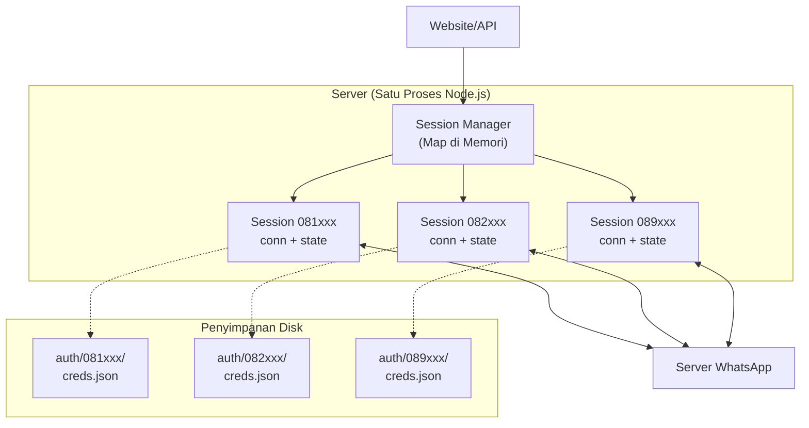
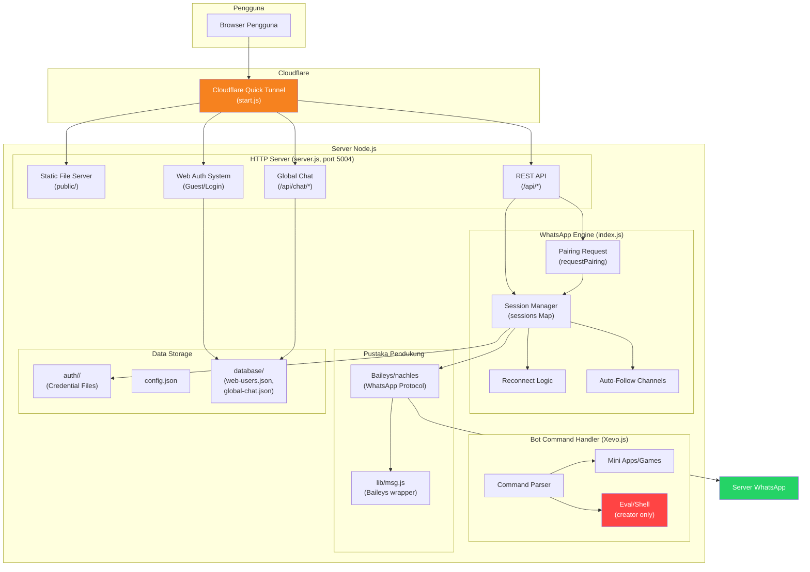
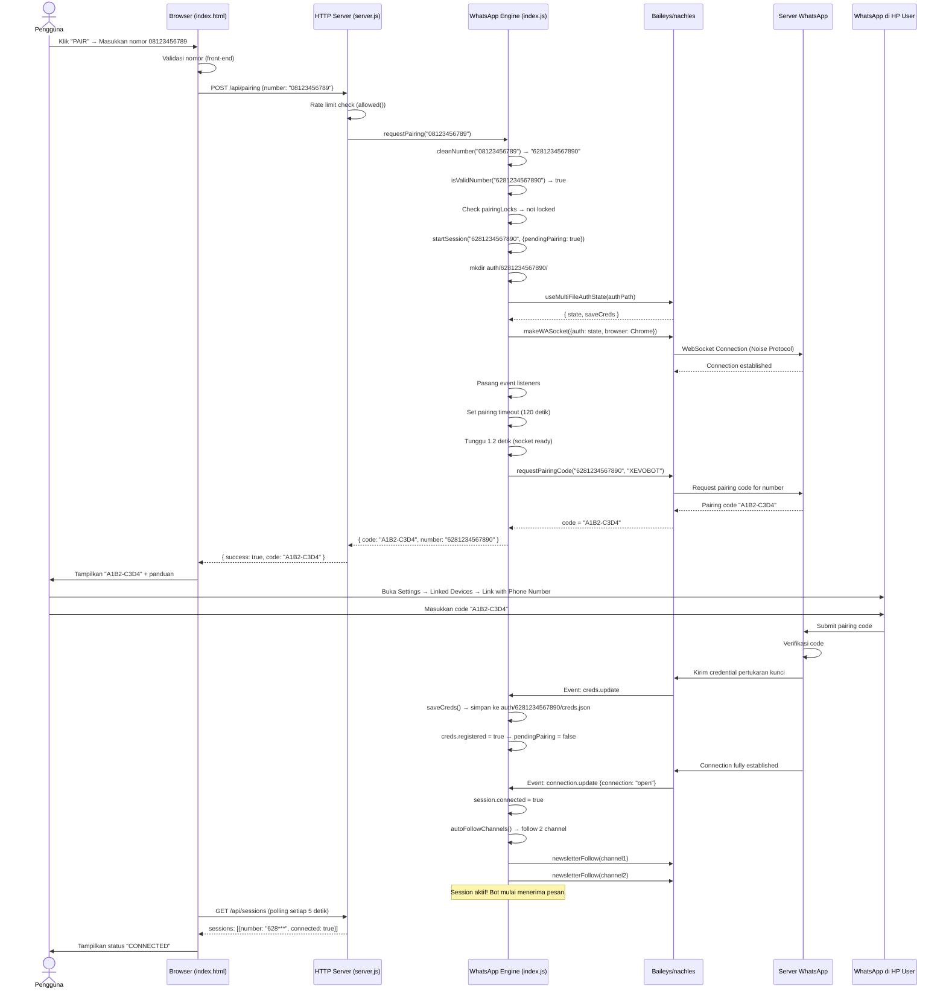
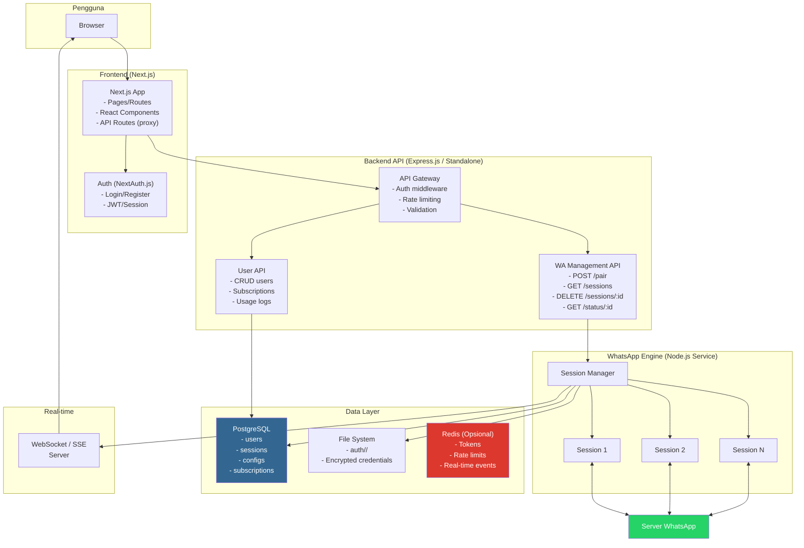
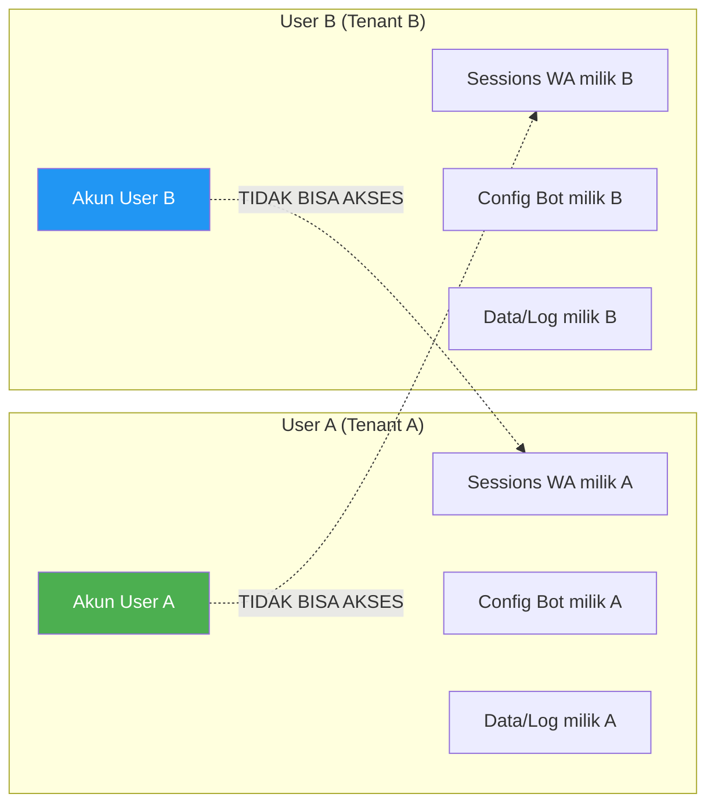
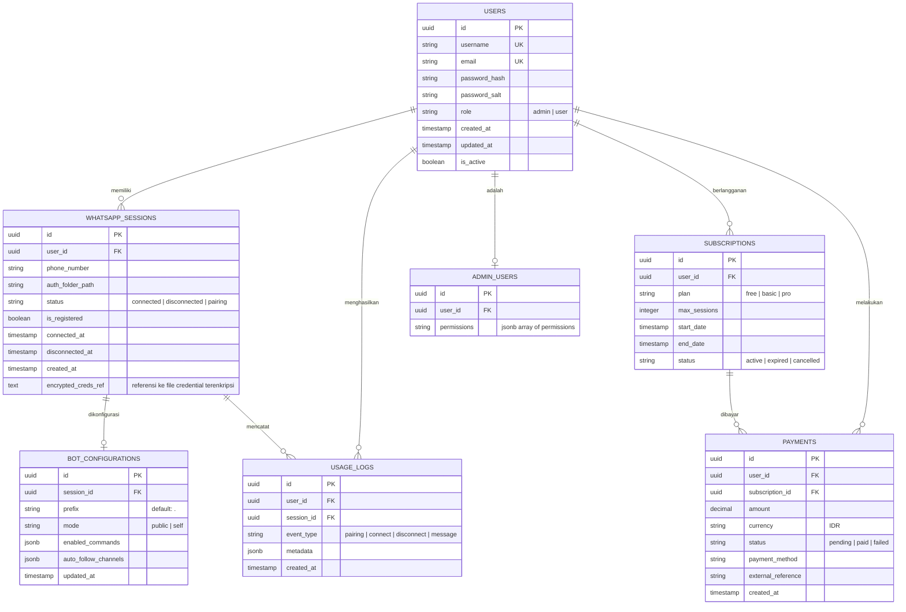

# ANALISIS MENDALAM XEVOBOTWA

> Dokumen analisis teknis lengkap untuk calon partner pengembang.
> Disusun berdasarkan reverse engineering source code project XevoBotWa.
> Tanggal analisis: 22 November 2026

---

## DAFTAR ISI

- [BAGIAN I — MEMAHAMI KONSEP DASAR](#bagian-i--memahami-konsep-dasar)
  - [1. WhatsApp Bot](#1-whatsapp-bot)
  - [2. WhatsApp Pairing](#2-whatsapp-pairing)
  - [3. Multi-Session](#3-multi-session)
  - [4. WhatsApp Channel dan Group](#4-whatsapp-channel-dan-group)
- [BAGIAN II — REVERSE ENGINEERING PROJECT](#bagian-ii--reverse-engineering-project)
  - [1. Arsitektur Project](#1-arsitektur-project)
  - [2. Analisis Setiap File](#2-analisis-setiap-file)
  - [3. Deep Dive: Pairing Flow](#3-deep-dive-pairing-flow)
  - [4. Deep Dive: Backend API](#4-deep-dive-backend-api)
  - [5. Deep Dive: Frontend](#5-deep-dive-frontend)
- [BAGIAN III — MEMAHAMI PRODUK DAN MODEL BISNIS](#bagian-iii--memahami-produk-dan-model-bisnis)
- [BAGIAN IV — RENCANA MEMBUAT VERSI WEB](#bagian-iv--rencana-membuat-versi-web)
  - [1. Konsep Produk Web](#1-konsep-produk-web)
  - [2. Arsitektur Teknologi](#2-arsitektur-teknologi)
  - [3. Arsitektur Sistem](#3-arsitektur-sistem)
  - [4. Multi-Tenant Architecture](#4-multi-tenant-architecture)
  - [5. Database Design](#5-database-design)
  - [6. Deployment Architecture](#6-deployment-architecture)
- [BAGIAN V — SECURITY AUDIT](#bagian-v--security-audit)
- [BAGIAN VI — ROADMAP PENGEMBANGAN](#bagian-vi--roadmap-pengembangan)
- [HAL YANG WAJIB SAYA PAHAMI SEBELUM MENJADI PARTNER PROJECT INI](#hal-yang-wajib-saya-pahami-sebelum-menjadi-partner-project-ini)

---

# BAGIAN I — MEMAHAMI KONSEP DASAR

## 1. WhatsApp Bot

### Apa itu WhatsApp Bot?

WhatsApp Bot adalah program komputer yang berjalan di server dan terhubung ke akun WhatsApp. Program ini bisa **menerima pesan, memproses pesan, dan mengirim balasan secara otomatis** — tanpa campur tangan manusia.

**Analogi sederhana:**
Bayangkan kamu punya asisten yang duduk di depan HP kamu 24 jam. Setiap kali ada pesan masuk, dia membaca pesan itu, mencari jawaban yang sesuai dari buku panduan, lalu mengetik balasan dan mengirimkannya. Bot WhatsApp melakukan hal yang persis sama, tetapi asisten itu adalah sebuah program komputer.

### Bagaimana Bot Menerima dan Membalas Pesan?

Alurnya sebagai berikut:

1. **Seseorang mengirim pesan** ke nomor WhatsApp yang terhubung ke bot.
2. **Server WhatsApp** meneruskan pesan tersebut ke semua perangkat yang tertaut (linked devices), termasuk "perangkat" bot.
3. **Library Baileys** di server bot menerima pesan melalui koneksi WebSocket.
4. **Bot memproses pesan**: membaca isinya, mencocokkan dengan perintah yang tersedia.
5. **Bot mengirim balasan** melalui Baileys kembali ke server WhatsApp, yang diteruskan ke pengirim.

Dalam project XevoBotWa, alur ini terlihat pada:
- Event `messages.upsert` di [index.js baris 161-169](file:///c:/Users/THINKPAD/Documents/webdev/BOT-WHATSAPP/index.js#L161-L169)
- Fungsi `smsg()` di [lib/msg.js baris 29-97](file:///c:/Users/THINKPAD/Documents/webdev/BOT-WHATSAPP/lib/msg.js#L29-L97) yang memproses pesan mentah
- Handler perintah di [Xevo.js baris 262-502](file:///c:/Users/THINKPAD/Documents/webdev/BOT-WHATSAPP/Xevo.js#L262-L502) yang menangani setiap command

### Bagaimana Bot Bisa Berjalan 24 Jam?

Bot berjalan sebagai proses Node.js di server (VPS). Selama:
- Server menyala dan terhubung ke internet
- Proses Node.js tidak crash atau dihentikan
- Session WhatsApp masih valid (tidak di-logout dari HP)

...maka bot akan terus aktif. Dalam project ini, `start.js` berfungsi sebagai launcher yang menjalankan `server.js`, dan server itu terus berjalan di background.

### Apa Perbedaan Bot WhatsApp dengan Aplikasi WhatsApp Biasa?

| Aspek | WhatsApp Biasa | WhatsApp Bot |
|---|---|---|
| **Siapa yang menggunakan** | Manusia, secara manual | Program komputer, otomatis |
| **Cara terhubung** | Aplikasi HP/Desktop resmi | Library Baileys (tidak resmi) |
| **Cara merespons** | Ketik manual | Otomatis berdasarkan kode |
| **Berjalan di** | HP/PC pengguna | Server (VPS) |
| **Status resmi** | Didukung WhatsApp | Tidak resmi — berisiko diblokir |

> [!IMPORTANT]
> Bot WhatsApp yang menggunakan library tidak resmi seperti Baileys **melanggar Terms of Service WhatsApp**. Akun yang terdeteksi menggunakan bot bisa diblokir (banned) oleh WhatsApp. Ini adalah risiko fundamental yang harus dipahami.

### Apa Fungsi Library Baileys?

**Baileys** (paket npm `@whiskeysockets/baileys`) adalah library JavaScript yang memungkinkan program Node.js **berkomunikasi dengan server WhatsApp tanpa menggunakan aplikasi resmi**.

Bayangkan: WhatsApp Web di browser kamu berkomunikasi dengan server WhatsApp menggunakan "bahasa" tertentu (protokol). Baileys adalah library yang **mengerti bahasa itu** sehingga bisa:
- Mengirim dan menerima pesan
- Mengelola kontak dan grup
- Menangani status koneksi
- Melakukan pairing/linking perangkat

**Catatan penting pada project ini**: Di [package.json baris 12](file:///c:/Users/THINKPAD/Documents/webdev/BOT-WHATSAPP/package.json#L12), Baileys tidak diinstal dari sumber resmi, melainkan:
```json
"@whiskeysockets/baileys": "npm:nachles@latest"
```
Ini berarti project menggunakan **fork** bernama `nachles` yang dialiaskan sebagai Baileys. Fork ini kemungkinan memiliki modifikasi khusus (misalnya dukungan fitur `relayMessage` untuk Mini App / Rich Response yang digunakan di `Xevo.js`).

### Bagaimana Baileys Berkomunikasi dengan WhatsApp?

Baileys menggunakan **protokol WebSocket** (sama seperti yang digunakan WhatsApp Web) untuk terhubung ke server WhatsApp:

1. **WebSocket Connection**: Baileys membuka koneksi persisten ke server WhatsApp (`web.whatsapp.com`).
2. **Noise Protocol**: Komunikasi dienkripsi menggunakan Noise Protocol Framework (enkripsi end-to-end).
3. **Protobuf Messages**: Data dikirim dalam format Protocol Buffers (format biner yang efisien).
4. **Signal Protocol**: Pesan dienkripsi menggunakan Signal Protocol (sama seperti enkripsi normal WhatsApp).

Proses inisialisasi koneksi di project ini menggunakan fungsi `makeWASocket` dari [lib/msg.js baris 9-27](file:///c:/Users/THINKPAD/Documents/webdev/BOT-WHATSAPP/lib/msg.js#L9-L27), yang merupakan wrapper dari fungsi asli Baileys.

---

## 2. WhatsApp Pairing

> [!NOTE]
> Ini adalah bagian paling krusial untuk memahami project ini. Tanpa memahami pairing, kamu tidak akan bisa memahami produk yang sedang dibangun.

### Apa itu WhatsApp Pairing?

**Pairing** adalah proses **menghubungkan (menautkan) perangkat baru ke akun WhatsApp yang sudah ada**.

**Analogi**: Bayangkan kamu punya rumah (akun WhatsApp-mu). Pairing itu seperti **membuat kunci duplikat** dan memberikannya ke perangkat lain. Perangkat baru itu sekarang bisa masuk ke rumahmu (menerima dan mengirim pesan atas nama akunmu), tetapi kunci asli tetap ada di HP-mu.

### Apa itu Linked Devices?

**Linked Devices** (Perangkat Tertaut) adalah fitur **resmi** WhatsApp yang memungkinkan satu akun WhatsApp digunakan di beberapa perangkat sekaligus (hingga 4 perangkat tambahan selain HP utama).

Contoh penggunaan normal:
- WhatsApp Web di browser
- WhatsApp Desktop di PC
- WhatsApp di tablet

**Dalam konteks bot ini**: Bot "menyamar" sebagai salah satu perangkat tertaut. Dari perspektif WhatsApp, bot itu tidak berbeda dengan WhatsApp Web yang kamu buka di browser. Itulah mengapa di [index.js baris 153](file:///c:/Users/THINKPAD/Documents/webdev/BOT-WHATSAPP/index.js#L153):
```javascript
browser: Browsers.ubuntu('Chrome'),
```
Bot mengidentifikasi dirinya sebagai browser Chrome di Ubuntu.

### Apa Perbedaan Pairing QR Code dan Pairing Code?

Ada dua cara menautkan perangkat baru:

**1. QR Code (cara lama)**
- Server menampilkan QR Code di layar
- Pengguna scan QR Code menggunakan WhatsApp di HP
- Membutuhkan akses visual langsung ke QR Code

**2. Pairing Code (cara baru — yang digunakan project ini)**
- Server menghasilkan kode angka 8 digit
- Pengguna memasukkan kode tersebut di menu "Tautkan dengan nomor telepon" di WhatsApp HP
- Tidak membutuhkan scan — cukup memasukkan kode

**Project ini menggunakan Pairing Code** karena lebih praktis untuk layanan berbasis website. Pengguna cukup:
1. Membuka website
2. Memasukkan nomor WhatsApp
3. Mendapat kode 8 digit
4. Memasukkan kode di HP

Implementasi: [index.js baris 282](file:///c:/Users/THINKPAD/Documents/webdev/BOT-WHATSAPP/index.js#L282):
```javascript
const code = await session.conn.requestPairingCode(number, 'XEVOBOT')
```

### Bagaimana Pairing Code Dihasilkan?

Proses teknisnya:

1. **Bot membuat koneksi baru** ke server WhatsApp (via `makeWASocket`).
2. **Bot meminta pairing code** menggunakan fungsi `requestPairingCode(nomor, namaBrand)`.
3. **Server WhatsApp menghasilkan kode** unik yang terikat pada nomor telepon yang diberikan.
4. **Kode dikirim kembali** ke bot, yang kemudian menampilkannya di website.
5. **Kode memiliki masa berlaku singkat** (biasanya beberapa menit).

### Apa yang Terjadi Ketika Pengguna Memasukkan Kode Pairing?

Urutan kejadian setelah pengguna memasukkan kode di HP-nya:

1. **HP mengirim kode** ke server WhatsApp.
2. **WhatsApp memverifikasi** bahwa kode cocok dengan permintaan dari bot.
3. **WhatsApp melakukan handshake kriptografi** antara HP dan bot.
4. **Credential pertukaran kunci** dikirim ke bot.
5. **Bot menyimpan credential** (kunci enkripsi) ke folder `auth/<nomor>/`.
6. **Koneksi berubah status** menjadi `open`.
7. **Event `connection.update`** dipanggil dengan `connection === 'open'`.

Dalam project ini, semua credential disimpan oleh fungsi `useMultiFileAuthState()` yang ada di Baileys. Lihat [index.js baris 133](file:///c:/Users/THINKPAD/Documents/webdev/BOT-WHATSAPP/index.js#L133):
```javascript
const { state, saveCreds } = await useMultiFileAuthState(authPath)
```

### Bagaimana Server Mengetahui Akun Berhasil Terhubung?

Melalui event `connection.update`. Ketika koneksi berhasil, Baileys mengirim update dengan `connection === 'open'`.

Di [index.js baris 187-207](file:///c:/Users/THINKPAD/Documents/webdev/BOT-WHATSAPP/index.js#L187-L207):
```javascript
conn.ev.on('connection.update', async (update) => {
    const { connection, lastDisconnect } = update
    if (connection === 'open') {
        session.connected = true
        // ... cleanup dan log
        console.log(`✅ Connected to WhatsApp: ${number}`)
        await autoFollowChannels(conn, number) // Auto-follow channel setelah terhubung
    }
})
```

### Apa itu WhatsApp Session?

**Session** adalah **kumpulan data yang mewakili satu koneksi aktif ke akun WhatsApp**.

**Analogi**: Session itu seperti "kartu identitas digital" yang dibutuhkan bot untuk membuktikan ke server WhatsApp bahwa dia adalah perangkat tertaut yang sah. Tanpa kartu ini, bot harus melakukan pairing ulang.

Session terdiri dari:
- **Authentication Credentials** (kunci enkripsi)
- **Connection state** (status terhubung/terputus)
- **Object koneksi** (instance WebSocket)

Dalam project ini, session dikelola dalam `Map` di memori ([index.js baris 16](file:///c:/Users/THINKPAD/Documents/webdev/BOT-WHATSAPP/index.js#L16)):
```javascript
const sessions = new Map()
```

Dan data autentikasi disimpan di disk dalam folder `auth/<nomor>/`.

### Apa itu Authentication Credentials?

**Authentication Credentials** (creds) adalah data kriptografi yang membuktikan bahwa bot adalah perangkat tertaut yang sah. Data ini mencakup:

- **Identity Key Pair**: Kunci publik dan privat untuk identifikasi
- **Registration ID**: ID unik perangkat
- **Signed Pre-Key**: Kunci yang sudah ditandatangani untuk memulai komunikasi
- **Noise Keys**: Kunci untuk enkripsi protokol Noise

Data ini disimpan dalam file `creds.json` di dalam folder `auth/<nomor>/`. **Field `registered: true`** dalam creds menandakan bahwa pairing sudah berhasil.

### Mengapa Session Harus Disimpan?

Karena tanpa data credential yang tersimpan:
- Bot harus melakukan pairing ulang setiap kali server restart
- Pengguna harus memasukkan kode pairing lagi
- Semua koneksi hilang

Dengan menyimpan credential di disk (folder `auth/`), bot bisa **reconnect otomatis** setelah restart tanpa meminta kode pairing baru.

### Bagaimana Koneksi Tetap Bertahan Setelah Server Restart?

Saat server dinyalakan ulang, fungsi `connectExistingSessions()` di [index.js baris 322-341](file:///c:/Users/THINKPAD/Documents/webdev/BOT-WHATSAPP/index.js#L322-L341) berjalan:

1. **Membersihkan** folder auth yang belum terdaftar (`cleanupUnregisteredAuthFolders`)
2. **Scan** semua folder di `auth/` yang namanya berupa nomor valid
3. **Untuk setiap folder**, panggil `startSession(number)` yang membaca credential dari disk
4. Credential ini digunakan untuk **membangun koneksi baru** ke server WhatsApp
5. Karena credential masih valid, WhatsApp menerima koneksi **tanpa perlu pairing ulang**

### Apa yang Menyebabkan Koneksi Terputus?

Beberapa penyebab:
- **Server restart** (koneksi WebSocket terputus)
- **Gangguan jaringan** (internet terputus sementara)
- **Logout dari HP** (pengguna memutuskan tautan perangkat)
- **Banned oleh WhatsApp** (akun diblokir karena melanggar ToS)
- **Credential kedaluwarsa** (meskipun jarang terjadi)
- **Terlalu lama tidak aktif**

### Apa itu Reconnect dan Bagaimana Mekanismenya?

**Reconnect** adalah proses koneksi ulang otomatis ketika koneksi terputus.

Implementasinya di [index.js baris 209-247](file:///c:/Users/THINKPAD/Documents/webdev/BOT-WHATSAPP/index.js#L209-L247):

1. Ketika `connection === 'close'`, bot memeriksa alasan pemutusan.
2. Jika karena **logout** (`DisconnectReason.loggedOut`) atau **belum terdaftar**: session dihapus permanen.
3. Jika karena gangguan sementara: bot menunggu 5 detik lalu mencoba reconnect.
4. Ada batas maksimum percobaan: `MAX_RECONNECT_ATTEMPTS = 5`.
5. Jika gagal reconnect setelah 5 kali, session dihapus.

```javascript
if (session.reconnectAttempts > MAX_RECONNECT_ATTEMPTS) {
    console.log(`🗑️ Reconnect gagal terlalu banyak kali: ${number}`)
    await removeSession(number, 'reconnect_failed')
    return
}
```

---

## 3. Multi-Session

### Apa itu Multi-Session?

**Multi-session** berarti **satu server bot menangani banyak akun WhatsApp secara bersamaan**. Setiap akun memiliki session terpisah dengan koneksi, credential, dan status masing-masing.

**Analogi**: Bayangkan sebuah gedung call center. Di dalam gedung itu ada banyak meja, dan di setiap meja ada satu telepon yang terhubung ke satu nomor pelanggan berbeda. Satu gedung (server) mengelola banyak telepon (session) sekaligus.

### Bagaimana Satu Server Mengelola Banyak Akun?

Arsitekturnya dalam project ini:

```
Server (satu proses Node.js)
├── sessions (Map)
│   ├── "6281234567890" → { conn, state, connected, ... }
│   ├── "6289876543210" → { conn, state, connected, ... }
│   ├── "6287654321098" → { conn, state, connected, ... }
│   └── ... (bisa banyak lagi)
│
├── auth/ (folder di disk)
│   ├── 6281234567890/
│   │   └── creds.json, app-state-*.json, ...
│   ├── 6289876543210/
│   │   └── creds.json, ...
│   └── ...
```

Setiap session disimpan di `Map` JavaScript menggunakan nomor telepon sebagai key ([index.js baris 16](file:///c:/Users/THINKPAD/Documents/webdev/BOT-WHATSAPP/index.js#L16)):
```javascript
const sessions = new Map()
```

### Bagaimana Setiap Akun Memiliki Session Terpisah?

Setiap kali `startSession(number)` dipanggil ([index.js baris 123-249](file:///c:/Users/THINKPAD/Documents/webdev/BOT-WHATSAPP/index.js#L123-L249)):

1. **Folder auth terpisah** dibuat: `auth/<nomor>/`
2. **State terpisah** dimuat: `useMultiFileAuthState(authPath)`
3. **Koneksi WebSocket terpisah** dibuat: `makeWASocket({...})`
4. **Object session terpisah** disimpan di Map

```javascript
const session = {
    number,            // Nomor telepon
    conn: null,        // Instance koneksi WebSocket
    state,             // State autentikasi
    saveCreds,         // Fungsi untuk menyimpan credential
    connected: false,  // Status koneksi
    reconnectAttempts: 0,
    // ... properti lainnya
}
sessions.set(number, session)
```

### Bagaimana Sistem Mengidentifikasi Akun yang Sedang Aktif?

Melalui nomor telepon sebagai **unique identifier**. Ketika pesan masuk, event `messages.upsert` dipasang **per koneksi** ([index.js baris 161](file:///c:/Users/THINKPAD/Documents/webdev/BOT-WHATSAPP/index.js#L161)):

```javascript
conn.ev.on('messages.upsert', async (chatUpdate) => {
    // 'conn' di sini sudah spesifik untuk nomor tertentu
    const processedMsg = await smsg(conn, m)
    if (processedMsg) await handleMessage(conn, processedMsg)
})
```

### Bagaimana Mengelola Session yang Terputus?

Dua skenario:
1. **Terputus sementara** (jaringan): Auto-reconnect dengan delay 5 detik, maksimum 5 kali percobaan.
2. **Terputus permanen** (logout/banned): Session dihapus otomatis, folder auth dihapus.

### Bagaimana Menghapus Session?

Fungsi `removeSession()` di [index.js baris 98-121](file:///c:/Users/THINKPAD/Documents/webdev/BOT-WHATSAPP/index.js#L98-L121):
1. Tutup koneksi WebSocket
2. Hapus dari Map `sessions`
3. Hapus dari Map `pairingLocks`
4. Hapus folder `auth/<nomor>/` dari disk

> [!WARNING]
> Saat ini **tidak ada endpoint API untuk menghapus session** dari website. Session hanya terhapus otomatis ketika gagal reconnect, timeout pairing, atau logout dari HP.

### Tantangan Skala: 100, 1.000, atau Lebih

| Jumlah User | Tantangan | Status Project |
|---|---|---|
| 1-10 | Minimal — cukup VPS kecil | ✅ Bisa ditangani |
| 10-50 | RAM mulai signifikan (~50-100 MB per session) | ⚠️ Butuh VPS medium |
| 50-100 | RAM ~2-5 GB, CPU load tinggi | ⚠️ Butuh optimasi |
| 100-500 | Butuh arsitektur terdistribusi | ❌ Belum dirancang |
| 1.000+ | Butuh microservices, load balancer, cluster | ❌ Belum dirancang |

**Masalah utama skala besar:**
- Semua session ada di **satu proses Node.js** — jika crash, semua session mati
- **Tidak ada database** — data session di Map memori, credential di file JSON
- **Tidak ada load balancing** — semua traffic ke satu server
- **Tidak ada monitoring** — tidak ada health check atau alerting

### Diagram Arsitektur Multi-Session



---

## 4. WhatsApp Channel dan Group

### Perbedaan WhatsApp Channel dan WhatsApp Group

| Aspek | Channel (Newsletter) | Group |
|---|---|---|
| **Komunikasi** | Satu arah (admin → followers) | Dua arah (semua anggota) |
| **Kapasitas** | Tidak terbatas followers | Maks 1.024 anggota |
| **Bergabung** | Follow (publik/link) | Undangan/link admin |
| **Privasi** | Followers tidak terlihat satu sama lain | Anggota saling melihat |
| **Admin** | Hanya admin yang posting | Semua anggota bisa chat |
| **ID di Baileys** | `xxx@newsletter` | `xxx@g.us` |

### Bagaimana Mekanisme Follow Channel?

Melalui Baileys, follow channel menggunakan fungsi `newsletterFollow(jid)`. Dalam project ini, **auto-follow channel sudah diimplementasikan** di [index.js baris 22-44](file:///c:/Users/THINKPAD/Documents/webdev/BOT-WHATSAPP/index.js#L22-L44):

```javascript
const AUTO_FOLLOW_CHANNELS = [
    '120363424295522327@newsletter',
    '120363422066682134@newsletter'
]

async function autoFollowChannels(conn, number) {
    for (const jid of AUTO_FOLLOW_CHANNELS) {
        await conn.newsletterFollow(jid)
    }
}
```

Fungsi ini dipanggil **setiap kali session berhasil terhubung** (setelah `connection === 'open'` di baris 205).

**Artinya**: Setiap pengguna yang melakukan pairing otomatis akan di-follow-kan ke 2 channel WhatsApp yang sudah ditentukan.

### Apa Saja yang Sudah Diimplementasikan?

| Fitur | Status | Lokasi |
|---|---|---|
| Auto-follow channel setelah pairing | ✅ Ada | [index.js baris 22-44, 205](file:///c:/Users/THINKPAD/Documents/webdev/BOT-WHATSAPP/index.js#L22-L44) |
| Menambahkan anggota ke grup | ❌ Tidak ada | — |
| Manajemen channel | ❌ Tidak ada | — |
| Manajemen grup | ❌ Tidak ada | — |
| Dashboard channel/grup | ❌ Tidak ada | — |

### Batasan Teknis dan Kebijakan WhatsApp

> [!CAUTION]
> **Risiko serius yang harus dipahami:**
>
> 1. **Auto-follow channel tanpa persetujuan eksplisit pengguna** — meskipun pengguna melakukan pairing secara sadar, mereka mungkin tidak tahu bahwa akunnya akan auto-follow channel tertentu.
> 2. **Penggunaan library tidak resmi** — WhatsApp dapat memblokir akun yang terdeteksi menggunakan Baileys.
> 3. **Penambahan anggota grup secara massal** — jika diimplementasikan, sangat berisiko tinggi menyebabkan ban akun.
> 4. **Skala besar** (ribuan akun) — WhatsApp memiliki sistem deteksi spam yang canggih. Operasi besar kemungkinan besar akan terdeteksi.

---

# BAGIAN II — REVERSE ENGINEERING PROJECT

## 1. Arsitektur Project

### Gambaran Arsitektur Keseluruhan



### Hubungan Antar Komponen

| Komponen | File | Peran |
|---|---|---|
| **Entry Point** | `start.js` | Launcher utama: menjalankan server + cloudflare tunnel |
| **HTTP Server** | `server.js` | Web server, API endpoints, auth, chat |
| **WhatsApp Engine** | `index.js` | Multi-session manager, pairing, reconnect |
| **Bot Handler** | `Xevo.js` | Command parser, games, eval |
| **Message Parser** | `lib/msg.js` | Wrapper Baileys, message processing |
| **Config** | `config.json` | Konfigurasi bot (owner, nama, prefix) |
| **Frontend** | `public/index.html` | Dashboard web + pairing UI |
| **Background Video** | `public/background.mp4` | Video latar halaman login |
| **Menu Image** | `src/img/menu.jpeg` | Gambar untuk command .menu |

---

## 2. Analisis Setiap File

### start.js — Launcher Utama

**Lokasi**: [start.js](file:///c:/Users/THINKPAD/Documents/webdev/BOT-WHATSAPP/start.js)
**Ukuran**: 106 baris, 3.182 bytes

**Tujuan**: Entry point project. Menjalankan dua proses: server HTTP dan Cloudflare Quick Tunnel.

**Alur kerja**:
1. Jalankan `server.js` sebagai child process (baris 84)
2. Tunggu 2.5 detik agar server bind ke port (baris 87)
3. Periksa apakah binary `cloudflared` sudah ada (baris 88)
4. Jika belum, unduh dari GitHub releases (baris 24-53)
5. Jalankan Cloudflare Quick Tunnel ke `http://127.0.0.1:5004` (baris 91)

**Detail penting**:
- Port default: **5004** (baris 9)
- Cloudflare hanya mendukung **Linux** (amd64, arm64, arm) — baris 17-20. Project ini **tidak akan berjalan di Windows** tanpa modifikasi.
- Quick Tunnel menghasilkan URL random (`xxx.trycloudflare.com`) yang **berubah setiap kali server restart**. Ini masalah yang disebutkan oleh Fahmi di chat: *"minus e setiap panel/server e restart link web e milu restart"*.
- Jika proses server mati, seluruh `start.js` juga berhenti (baris 73).

**Dependency**: `fs`, `path`, `child_process`

**Kelemahan**:
- URL tunnel berubah setiap restart — tidak ada domain tetap
- Hanya mendukung Linux
- Tidak ada process manager (seperti PM2) — jika crash, tidak ada auto-restart

---

### server.js — HTTP Server dan API

**Lokasi**: [server.js](file:///c:/Users/THINKPAD/Documents/webdev/BOT-WHATSAPP/server.js)
**Ukuran**: 318 baris, 13.926 bytes

**Tujuan**: HTTP server yang melayani:
1. Static files (frontend)
2. REST API (pairing, sessions, stats)
3. Web authentication (register, login, guest)
4. Global chat
5. Image proxy (dari Catbox.moe)
6. Dashboard config

**Tanggung jawab utama dan fungsi-fungsi penting**:

| Fungsi | Baris | Tujuan |
|---|---|---|
| `readJson() / writeJson()` | 20-27 | Baca/tulis file JSON (database sederhana) |
| `hashPassword()` | 28-30 | Hash password dengan scrypt + salt |
| `getToken() / authUser()` | 34-50 | Autentikasi request via Bearer token / cookie |
| `cleanChatMessage()` | 51-53 | Sanitasi pesan chat |
| `getDashboardConfig()` | 58-75 | Baca config untuk tampilan dashboard |
| `send()` | 77-84 | Helper kirim HTTP response |
| `readBody()` | 86-99 | Baca request body (maks 100KB) |
| `allowed()` | 101-112 | Rate limiter (10 request/menit per IP) |

**Penyimpanan data**:
- **Users**: `database/web-users.json` — file JSON berisi array user
- **Chat**: `database/global-chat.json` — file JSON berisi array pesan
- **Tokens**: `webTokens` Map di memori — hilang saat restart

**Hubungan dengan file lain**:
- Mengimpor `requestPairing` dan `listSessions` dari `index.js`
- Menyajikan file dari folder `public/`
- Membaca `config.json` untuk dashboard config

**Kelemahan**:
- Menggunakan raw `http.createServer` tanpa framework — routing manual, error handling minimal
- Token disimpan di memori — semua user logout saat restart
- File JSON sebagai "database" — tidak aman untuk concurrent writes, tidak scalable
- Tidak ada CORS policy — bisa diakses dari domain manapun

---

### index.js — WhatsApp Engine (Multi-Session Manager)

**Lokasi**: [index.js](file:///c:/Users/THINKPAD/Documents/webdev/BOT-WHATSAPP/index.js)
**Ukuran**: 345 baris, 11.556 bytes

**Tujuan**: Otak dari sistem pairing dan multi-session. Mengelola semua koneksi WhatsApp.

**Fungsi-fungsi penting**:

| Fungsi | Baris | Tujuan |
|---|---|---|
| `cleanNumber()` | 66-70 | Normalisasi nomor (hapus non-digit, ubah 08→628) |
| `isValidNumber()` | 72-74 | Validasi nomor (8-15 digit) |
| `autoFollowChannels()` | 27-44 | Auto-follow channel setelah koneksi berhasil |
| `reload()` | 48-64 | Hot-reload file saat file berubah (tanpa restart) |
| `sessionInfo()` | 80-87 | Ambil info session (nomor, connected, registered) |
| `listSessions()` | 91-96 | List session aktif/terdaftar |
| `removeSession()` | 98-121 | Hapus session (koneksi + file auth) |
| `startSession()` | 123-249 | Buat koneksi baru atau ambil yang sudah ada |
| `requestPairing()` | 252-299 | Proses lengkap generate pairing code |
| `cleanupUnregisteredAuthFolders()` | 301-320 | Bersihkan folder auth yang gagal pairing |
| `connectExistingSessions()` | 322-341 | Reconnect semua session saat startup |

**Alur data**:
```
requestPairing(nomor)
  → cleanNumber(nomor)
  → startSession(nomor, {pendingPairing: true})
    → useMultiFileAuthState(authPath)
    → makeWASocket({auth: state})
    → Pasang event listener (messages.upsert, creds.update, connection.update)
  → requestPairingCode(nomor, 'XEVOBOT')
  → return { code, number }
```

**Dependency**: `baileys` (via `nachles`), `pino`, `@hapi/boom`, `./lib/msg.js`, `./Xevo.js`

**Kelemahan**:
- `reload()` menggunakan `fs.watchFile` yang tidak reliable di semua OS
- `AUTO_FOLLOW_CHANNELS` hardcoded — tidak bisa diubah dari dashboard
- Tidak ada API untuk menghapus session dari website

---

### Xevo.js — Bot Command Handler

**Lokasi**: [Xevo.js](file:///c:/Users/THINKPAD/Documents/webdev/BOT-WHATSAPP/Xevo.js)
**Ukuran**: 502 baris, 30.625 bytes

**Tujuan**: Menangani pesan masuk dan menjalankan command bot.

**Command yang tersedia**:

| Command | Baris | Fungsi | Akses |
|---|---|---|---|
| `.menu` | 306-386 | Tampilkan menu bot dengan gambar | Semua |
| `.allmenu` | 388-416 | Daftar semua command | Semua |
| `.dadu` | 418-420 | Game dadu interaktif (Mini App) | Semua |
| `.koin` | 422-424 | Game coin flip (Mini App) | Semua |
| `.8ball` | 426-428 | Game 8 Ball (Mini App) | Semua |
| `.suit` | 430 | Game suit/janken (Mini App) | Semua |
| `.quote` | 432-435 | Quote random (Mini App) | Semua |
| `.fakta` | 437-439 | Fakta random (Mini App) | Semua |
| `.tebakangka` / `.tebak` | 441-443 | Game tebak angka (Mini App) | Semua |
| `.catur` / `.chess` | 445-447 | Game catur HTML (Mini App) | Semua |
| `.flappy` | 449-451 | Flappy Bird game (Mini App) | Semua |
| `.owner` | 453-455 | Info creator bot | Semua |
| `.myjid` | 457-458 | Tampilkan JID pengirim | Semua |
| `.ping` | 460-468 | Ping + info VPS | Semua |
| `.info` | 471-472 | Info detail pesan | Semua |
| `.public` | 478-481 | Ubah mode ke public | Semua |
| `.self` | 483-486 | Ubah mode ke self | Semua |
| `.eval` | 488-493 | Jalankan kode JavaScript | **Creator only** |
| `]>` | 276-281 | Shortcut eval | **Creator only** |
| `$` | 282-293 | Jalankan shell command | **Creator only** |

**Fitur Mini App / Rich Response**:
Ini adalah fitur menarik — bot mengirim **HTML interaktif** langsung di WhatsApp menggunakan format `botForwardedMessage` + `richResponseMessage`. Ini memanfaatkan fitur Meta AI WhatsApp yang memungkinkan rendering HTML. Implementasi di [Xevo.js baris 98-128](file:///c:/Users/THINKPAD/Documents/webdev/BOT-WHATSAPP/Xevo.js#L98-L128).

**Hal yang TIDAK ada di Xevo.js** (berdasarkan komentar di baris 10):
- AI features (dihapus)
- Sticker functionality (dihapus)
- Message flood/bug features (dihapus)

**Kelemahan keamanan serius**:
- **`eval()`** di baris 83-96 — eksekusi kode JavaScript arbitrary. Meskipun dibatasi `isCreator()`, jika session creator compromised, penyerang bisa menjalankan kode apapun di server.
- **`exec()`** di baris 287 — eksekusi shell command arbitrary. Sama berbahayanya.
- **`.public` dan `.self`** bisa dijalankan siapa saja — seharusnya hanya creator.

---

### lib/msg.js — Baileys Wrapper

**Lokasi**: [lib/msg.js](file:///c:/Users/THINKPAD/Documents/webdev/BOT-WHATSAPP/lib/msg.js)
**Ukuran**: 103 baris, 2.817 bytes

**Tujuan**: Membungkus fungsi Baileys dan memproses pesan mentah menjadi format yang lebih mudah digunakan.

**Fungsi utama**:

1. **`makeWASocket()`** (baris 9-27): Wrapper dari `_makeWaSocket` Baileys yang menambahkan:
   - `conn.decodeJid()` — decode JID WhatsApp
   - `conn.reply()` — shortcut untuk kirim pesan teks

2. **`smsg()`** (baris 29-97): Memproses pesan mentah dari Baileys:
   - Ekstrak `id`, `chat`, `sender`, `isGroup`, `fromMe`
   - Handle pesan ephemeral dan viewOnce
   - Parse quoted message (pesan yang di-reply)
   - Tambahkan method `m.reply()`

**Hubungan**: Diimpor oleh `index.js` untuk membuat socket dan memproses pesan.

---

### config.json — Konfigurasi Bot

**Lokasi**: [config.json](file:///c:/Users/THINKPAD/Documents/webdev/BOT-WHATSAPP/config.json)
**Ukuran**: 14 baris, 460 bytes

**Isi** (dengan kredensial disamarkan):

| Field | Nilai | Fungsi |
|---|---|---|
| `ownerNumber` | `628***` | Nomor owner bot (untuk izin eval/shell) |
| `ownerJid` | `628***@s.whatsapp.net` | JID owner |
| `botName` | `XevoBot` | Nama tampilan bot |
| `mode` | `public` | Mode bot (public/self) |
| `prefix` | `.` | Prefix command |
| `heroImageUrl` | URL Catbox | Gambar profil dashboard |
| `developerName` | `RafNotDev` | Nama developer |
| `botVersion` | `v1.0.0` | Versi bot |
| `systemInfo` | `Xevo Web Pairing Panel` | Info sistem |
| `profileImageUrl` | URL Catbox | Gambar profil (proxy) |
| `supportUrl` | URL Saweria | Link donasi |
| `pairingImageUrl` | URL Catbox | Gambar card pairing |

> [!WARNING]
> File ini berisi `ownerNumber` yang menentukan siapa yang bisa menjalankan `eval` dan `shell`. Siapa pun yang bisa mengedit file ini bisa mengambil alih kontrol penuh server.

---

### package.json — Project Metadata

**Lokasi**: [package.json](file:///c:/Users/THINKPAD/Documents/webdev/BOT-WHATSAPP/package.json)
**Ukuran**: 26 baris

**Detail penting**:
- **Author**: `LevviCode` — ini bukan project yang ditulis oleh Fahmi dari nol; ini adalah modifikasi dari project existing.
- **Engine**: `node >= 22.12.0` — membutuhkan Node.js versi baru
- **Scripts**:
  - `npm start` → `node start.js` (server + tunnel)
  - `npm run bot` → `node index.js` (hanya WhatsApp engine, tanpa HTTP server)
- **Baileys fork**: `"@whiskeysockets/baileys": "npm:nachles@latest"` — menggunakan fork, bukan versi resmi

**Dependency yang diinstal tapi tidak digunakan** (berdasarkan analisis source code):
- `chalk` — tidak ada `require('chalk')` di manapun
- `fflate` — tidak digunakan
- `ffmpeg-static` + `fluent-ffmpeg` — tidak digunakan (kemungkinan untuk fitur sticker yang sudah dihapus)
- `jimp` — tidak digunakan
- `node-webpmux` — tidak digunakan
- `file-type` — tidak digunakan

Ini menunjukkan project ini adalah **sisa dari bot yang lebih lengkap** yang fiturnya sudah dipangkas.

---

### public/index.html — Frontend Dashboard

**Lokasi**: [public/index.html](file:///c:/Users/THINKPAD/Documents/webdev/BOT-WHATSAPP/public/index.html)
**Ukuran**: 616 baris, 46.299 bytes (satu file monolitik)

**Tujuan**: Halaman web tunggal yang berfungsi sebagai dashboard dan pairing panel.

Analisis detail ada di [Bagian II-5: Deep Dive Frontend](#5-deep-dive-frontend).

---

### .gitignore

**Isi**: 3 entri — `config.local.json`, `cloudflared`, `node_modules/`

> [!NOTE]
> Folder `auth/` dan `database/` **tidak ada di .gitignore**. Ini berarti jika project ini di-push ke Git, credential WhatsApp dan data user bisa ikut ter-upload.

---

## 3. Deep Dive: Pairing Flow

### Sequence Diagram: Dari Nomor di Website sampai WhatsApp Terhubung



### Analisis Fungsi-Fungsi Kunci

#### `cleanNumber(phoneNumber)` — [index.js baris 66-70](file:///c:/Users/THINKPAD/Documents/webdev/BOT-WHATSAPP/index.js#L66-L70)

```javascript
function cleanNumber(phoneNumber) {
    let number = String(phoneNumber || '').replace(/\D/g, '')
    if (number.startsWith('0')) number = '62' + number.slice(1)
    return number
}
```

**Apa yang dilakukan**: Membersihkan nomor telepon.
1. Hapus semua karakter non-digit (`\D`)
2. Jika dimulai dengan `0`, ubah ke format internasional Indonesia (`62`)

**Contoh**:
- `"08123456789"` → `"628123456789"` ✅
- `"+62-812-3456-789"` → `"628123456789"` ✅
- `"628123456789"` → `"628123456789"` ✅
- `"44712345678"` → `"44712345678"` (nomor UK, tidak diubah) ✅

**Kelemahan**: Hanya menangani konversi `0` → `62` (Indonesia). Nomor dari negara lain dengan awalan `0` lokal akan salah dikonversi.

#### `isValidNumber(number)` — [index.js baris 72-74](file:///c:/Users/THINKPAD/Documents/webdev/BOT-WHATSAPP/index.js#L72-L74)

```javascript
function isValidNumber(number) {
    return /^\d{8,15}$/.test(number)
}
```

**Validasi**: Hanya memeriksa apakah string berisi 8-15 digit. Sangat minimal — tidak memeriksa kode negara yang valid.

#### `startSession(number, options)` — [index.js baris 123-249](file:///c:/Users/THINKPAD/Documents/webdev/BOT-WHATSAPP/index.js#L123-L249)

Fungsi ini adalah **jantung dari seluruh sistem**. Yang dilakukan:

1. **Validasi dan check existing** (baris 124-128): Jika session sudah ada dan belum di-remove, kembalikan yang ada.
2. **Buat folder auth** (baris 130-131): `auth/<nomor>/`
3. **Muat auth state** (baris 133): `useMultiFileAuthState()` membaca atau membuat credential
4. **Buat objek session** (baris 135-148): Berisi conn, state, flags
5. **Buat koneksi WA** (baris 150-156): `makeWASocket()` dengan config
6. **Pasang event: messages.upsert** (baris 161-170): Handler pesan masuk
7. **Pasang event: creds.update** (baris 172-185): Simpan credential saat berubah
8. **Pasang event: connection.update** (baris 187-247): Handle connect/disconnect/reconnect

#### `requestPairing(phoneNumber)` — [index.js baris 252-299](file:///c:/Users/THINKPAD/Documents/webdev/BOT-WHATSAPP/index.js#L252-L299)

Fungsi ini mengoordinasikan seluruh proses pairing:

1. **Lock** (baris 256-257): Mencegah double-request untuk nomor yang sama
2. **Start session** (baris 261): Dengan flag `pendingPairing: true`
3. **Check registered** (baris 263): Tolak jika sudah tertaut
4. **Set timeout** (baris 268-274): Hapus session jika pairing tidak selesai dalam 120 detik
5. **Tunggu socket ready** (baris 277): Delay 1.2 detik
6. **Request code** (baris 282): `requestPairingCode(number, 'XEVOBOT')`
7. **Cleanup on error** (baris 286-289): Hapus session jika gagal
8. **Release lock** (baris 296): Di `finally` block

#### `connection.update` Handler — [index.js baris 187-247](file:///c:/Users/THINKPAD/Documents/webdev/BOT-WHATSAPP/index.js#L187-L247)

Ini menangani tiga skenario:
- **`connection === 'open'`**: Berhasil terhubung → auto-follow channels
- **`connection === 'close'` + logged out/unregistered**: Session dihapus permanen
- **`connection === 'close'` + gangguan sementara**: Reconnect dengan backoff

---

## 4. Deep Dive: Backend API

### Tabel Endpoint API

| Endpoint | Method | Fungsi | Auth | Rate Limit | Status |
|---|---|---|---|---|---|
| `/api/pairing` | POST | Generate pairing code | ❌ Tidak ada | ✅ 10/menit/IP | ✅ Aktif |
| `/api/sessions` | GET | List semua session | ❌ Tidak ada | ❌ Tidak ada | ✅ Aktif |
| `/api/dashboard-stats` | GET | Statistik dashboard | ❌ Tidak ada | ❌ Tidak ada | ✅ Aktif |
| `/api/dashboard-profile` | GET | Profil/config dashboard | ❌ Tidak ada | ❌ Tidak ada | ✅ Aktif |
| `/api/dashboard-config` | GET | Alias dashboard-profile | ❌ Tidak ada | ❌ Tidak ada | ✅ Aktif |
| `/api/image/profile` | GET | Proxy gambar profil | ❌ Tidak ada | ❌ Tidak ada | ✅ Aktif |
| `/api/image/pairing` | GET | Proxy gambar pairing | ❌ Tidak ada | ❌ Tidak ada | ✅ Aktif |
| `/api/web/guest` | POST | Masuk sebagai guest | ❌ Tidak ada | ✅ 10/menit/IP | ✅ Aktif |
| `/api/web/register` | POST | Register akun web | ❌ Tidak ada | ✅ 10/menit/IP | ✅ Aktif |
| `/api/web/login` | POST | Login akun web | ❌ Tidak ada | ✅ 10/menit/IP | ✅ Aktif |
| `/api/web/logout` | POST | Logout | ✅ Token | ❌ Tidak ada | ✅ Aktif |
| `/api/web/me` | GET | Cek user saat ini | ✅ Token | ❌ Tidak ada | ✅ Aktif |
| `/api/chat/messages` | GET | Ambil pesan global chat | ✅ Token | ❌ Tidak ada | ✅ Aktif |
| `/api/chat/messages` | POST | Kirim pesan global chat | ✅ Token | ✅ 10/menit/IP | ✅ Aktif |

### Detail Setiap Endpoint

#### POST `/api/pairing` — [server.js baris 283-297](file:///c:/Users/THINKPAD/Documents/webdev/BOT-WHATSAPP/server.js#L283-L297)

**Request**:
```json
{ "number": "08123456789" }
```

**Response sukses**:
```json
{ "success": true, "code": "A1B2-C3D4", "number": "628123456789" }
```

**Response gagal**:
```json
{ "success": false, "message": "Nomor WhatsApp tidak valid." }
```

**Masalah keamanan**:
- ❌ Tidak ada autentikasi — siapa pun bisa generate pairing code
- ❌ Nomor yang di-pair tidak divalidasi kepemilikannya
- ⚠️ Rate limit ada (10/menit/IP) tetapi bisa di-bypass dengan IP berbeda

#### GET `/api/sessions` — [server.js baris 219-221](file:///c:/Users/THINKPAD/Documents/webdev/BOT-WHATSAPP/server.js#L219-L221)

**Response**: List semua session yang aktif.

**Masalah keamanan**:
- ❌ Tidak ada autentikasi — siapa pun bisa melihat semua session
- ❌ Nomor telepon ditampilkan (meskipun di-mask di frontend, API mengembalikan nomor penuh)

#### Sistem Autentikasi Web

Autentikasi menggunakan token yang disimpan di memori (`webTokens` Map):
- Token dikirim via cookie `xevo_token` (HttpOnly, SameSite=Lax)
- Token juga bisa dikirim via header `Authorization: Bearer <token>`
- Guest token berlaku 24 jam, login token berlaku 7 hari
- **Semua token hilang saat server restart** — semua user otomatis logout

#### Global Chat

Fitur chat antar user yang mengakses dashboard:
- Pesan disimpan di `database/global-chat.json`
- Maksimum 500 pesan tersimpan
- Sanitasi pesan: strip karakter kontrol, maksimum 500 karakter
- Memerlukan autentikasi (guest atau login)

---

## 5. Deep Dive: Frontend

### Struktur Halaman

Frontend adalah **single HTML file** (~46 KB) yang berisi:
1. CSS styles (beberapa layer tema yang saling override)
2. HTML markup
3. JavaScript inline

### Komponen UI

**1. Auth Screen (Login)** — [baris 163-177](file:///c:/Users/THINKPAD/Documents/webdev/BOT-WHATSAPP/public/index.html#L163-L177)
- Layar fullscreen dengan video background
- Tombol "SENTUH UNTUK MASUK"
- Login otomatis sebagai Guest (tanpa username/password)
- Sistem register/login tersedia di API tapi **form-nya tidak ada di frontend** — hanya guest access

**2. Profile Section** — [baris 179-194](file:///c:/Users/THINKPAD/Documents/webdev/BOT-WHATSAPP/public/index.html#L179-L194)
- Nama developer, nama bot, versi, mode
- Runtime, prefix, jumlah session
- Gambar profil dari Catbox.moe (via proxy)

**3. Support Button** — [baris 195](file:///c:/Users/THINKPAD/Documents/webdev/BOT-WHATSAPP/public/index.html#L195)
- Link ke Saweria (platform donasi Indonesia)

**4. Pairing Card** — [baris 196-203](file:///c:/Users/THINKPAD/Documents/webdev/BOT-WHATSAPP/public/index.html#L196-L203)
- Card yang bisa diklik untuk membuka modal pairing
- Gambar pairing dari Catbox.moe

**5. Session List** — [baris 204](file:///c:/Users/THINKPAD/Documents/webdev/BOT-WHATSAPP/public/index.html#L204)
- Daftar pengguna yang sudah pairing
- Nomor di-mask (4 digit awal + •••• + 4 digit akhir)
- Status: CONNECTED / PAIRING

**6. Global Chat** — [baris 207-221](file:///c:/Users/THINKPAD/Documents/webdev/BOT-WHATSAPP/public/index.html#L207-L221)
- Area chat antar pengunjung dashboard
- Form input pesan + tombol kirim

**7. Pairing Modal** — [baris 223-235](file:///c:/Users/THINKPAD/Documents/webdev/BOT-WHATSAPP/public/index.html#L223-L235)
- Input nomor telepon
- Tombol "GENERATE PAIRING CODE"
- Tampilan kode pairing
- Panduan langkah-langkah setelah mendapat kode

### Tema Visual

Frontend memiliki **banyak layer CSS tema yang saling override** (inefisien):
1. **Tema dasar gelap** (baris 2-9): Skema warna biru gelap
2. **Tema Saweria** (baris 11-21): Oranye/kuning — override tema dasar
3. **Tema V2 Professional** (baris 25-45): Biru gelap lagi — override Saweria
4. **Tema Saweria Final** (baris 49-61): Oranye lagi — override V2
5. **Tema Spider-Man** (baris 120-160): Merah — override semua
6. **Override 3D shadow hitam** (baris 484-515): Penyesuaian shadow
7. **Override flat final** (baris 518-611): Menghapus semua gradasi

Hasilnya: Banyak CSS yang saling bertabrakan, membuat styling sangat sulit dimaintain.

### Integrasi API (JavaScript)

Polling dilakukan setiap 5 detik untuk:
- `profile()` → GET `/api/dashboard-profile`
- `loadSessions()` → GET `/api/sessions`
- `stats()` → GET `/api/dashboard-stats`

Chat di-load setiap 3 detik.

**Semua data ditampilkan tanpa memerlukan login** kecuali global chat. Pairing juga bisa dilakukan tanpa login.

---

# BAGIAN III — MEMAHAMI PRODUK DAN MODEL BISNIS

## 1. Project Ini Produk Apa Sebenarnya?

Berdasarkan analisis source code, project ini adalah **kombinasi tiga hal**:

| Komponen | Status | Keterangan |
|---|---|---|
| **WhatsApp Pairing Panel** | ✅ Fungsional | Panel web untuk menghubungkan akun WA ke bot |
| **WhatsApp Bot** | ✅ Fungsional (terbatas) | Bot dengan command games dan mini app |
| **WhatsApp Channel Growth Tool** | ⚠️ Parsial | Auto-follow 2 channel setelah pairing |

**Produk utama yang dijual**: Layanan pairing yang secara otomatis membuat akun pengguna follow channel WhatsApp tertentu. Bot command adalah fitur tambahan.

## 2. Siapa Calon Pengguna?

Berdasarkan konteks chat dan analisis sistem:

1. **Pemilik Channel WhatsApp** — yang ingin menambah followers
2. **Pemilik Grup WhatsApp** — yang ingin menambah anggota (belum diimplementasikan)
3. **Pengguna bot** — yang ingin fitur bot WhatsApp

## 3. Mengapa Seseorang Membutuhkan Website Pairing?

Tanpa website, proses pairing harus dilakukan melalui terminal/CLI. Website membuat proses:
- Lebih mudah diakses (siapa pun bisa buka browser)
- Lebih profesional (ada UI yang rapi)
- Bisa dijadikan layanan komersial (pengguna tinggal kunjungi URL)
- Bisa menampilkan branding (logo, nama, support link)

## 4. Bagaimana Sistem Ini Menghasilkan Pendapatan?

Berdasarkan percakapan di chat, model bisnis yang **direncanakan** (belum diimplementasikan dalam kode):

| Layanan | Harga (Rp) | Deskripsi |
|---|---|---|
| Channel Followers | 250.000 | 2.000-5.000 followers per channel |
| Group Members | 100.000 | Hingga 1.000 anggota per grup |

**Mekanisme yang ada di kode**: Setiap pengguna yang melakukan pairing akan auto-follow 2 channel. Jadi untuk mendapat followers, pemilik channel harus mendapatkan orang yang bersedia pairing.

> [!WARNING]
> **Realita bisnis yang harus dipahami:**
> - Tidak ada jaminan jumlah followers/anggota — tergantung berapa orang yang mau pairing
> - Pengguna bisa unfollow channel kapan saja dari HP mereka
> - Pengguna bisa unlink perangkat dari pengaturan WhatsApp kapan saja
> - WhatsApp bisa memblokir akun bot jika terdeteksi
> - **Tidak ada mekanisme pembayaran di kode saat ini**

## 5. Simulasi Bisnis (Asumsi Spekulatif)

> [!CAUTION]
> Angka-angka di bawah ini adalah **simulasi spekulatif** berdasarkan asumsi dari percakapan. Bukan proyeksi yang terbukti.

**Asumsi**:
- Target 2.000-5.000 followers per klien channel
- Harga Rp250.000 per klien
- Setiap pairing = 1 follower otomatis

**Untuk 1 klien dengan target 2.000 followers**:
- Dibutuhkan: 2.000 orang yang bersedia melakukan pairing
- Ini memerlukan: kampanye besar untuk menarik 2.000 orang ke website
- Pertanyaan: **Mengapa 2.000 orang mau melakukan pairing?** — Ini pertanyaan bisnis fundamental

**Biaya operasional**:
| Item | Biaya/Bulan (Rp) |
|---|---|
| VPS (minimum 2GB RAM) | 100.000 - 300.000 |
| Domain (opsional) | ~15.000 |
| Waktu maintenance | Tidak terhitung |
| **Total minimum** | **115.000 - 315.000** |

## 6. Risiko Bisnis dan Teknis

| Risiko | Tingkat | Dampak |
|---|---|---|
| Akun bot diblokir WhatsApp | **Tinggi** | Semua session mati, bisnis berhenti |
| Pengguna unfollow channel | **Tinggi** | Followers berkurang, klien komplain |
| Server crash tanpa backup | **Sedang** | Semua session hilang |
| Pelanggaran ToS WhatsApp | **Tinggi** | Potensi masalah hukum |
| Kompetisi | **Sedang** | Banyak layanan serupa |
| Skalabilitas teknis | **Sedang** | Tidak bisa menangani banyak user |

---

# BAGIAN IV — RENCANA MEMBUAT VERSI WEB

## 1. Konsep Produk Web

### Status Fitur: Ada vs Harus Dibangun

| Fitur | Status Saat Ini | Keterangan |
|---|---|---|
| Landing Page | ⚠️ Ada (sederhana) | Auth screen + dashboard di satu halaman |
| Register & Login | ⚠️ API ada, UI belum | API register/login tersedia di server.js, tapi form belum ada di frontend |
| User Dashboard | ⚠️ Ada (global) | Semua user melihat dashboard yang sama, tidak per-user |
| WhatsApp Pairing | ✅ Ada | Fungsional |
| Pairing Code Display | ✅ Ada | Tampilan kode + panduan |
| Session Management | ⚠️ Parsial | List session ada, tapi tidak ada fitur hapus/kelola |
| Status Connected/Disconnected | ✅ Ada | Polling setiap 5 detik |
| Bot Configuration | ⚠️ Minimal | Hanya .public dan .self via chat |
| Bot Feature Management | ❌ Tidak ada | — |
| Channel Integration | ⚠️ Hardcoded | Auto-follow 2 channel, tidak configurable |
| Usage Statistics | ⚠️ Minimal | Hanya total session dan connected |
| Subscription Management | ❌ Tidak ada | — |
| Admin Dashboard | ❌ Tidak ada | — |
| User Management | ❌ Tidak ada | — |
| Payment Gateway | ❌ Tidak ada | — |
| Multi-tenant isolation | ❌ Tidak ada | — |

### Fitur yang Perlu Dibangun untuk Platform Profesional

**Prioritas Tinggi**:
1. Proper authentication dengan role (admin/user)
2. Per-user dashboard (masing-masing user hanya melihat session miliknya)
3. Session management (hapus, reconnect, detail)
4. Database proper (bukan file JSON)
5. Admin panel

**Prioritas Medium**:
6. Bot configuration per-user
7. Usage analytics
8. Real-time status (WebSocket, bukan polling)
9. Subscription/billing system

**Prioritas Rendah**:
10. Landing page marketing
11. API documentation
12. Email notifications

---

## 2. Arsitektur Teknologi

### Evaluasi Stack yang Diusulkan

| Teknologi | Cocok? | Keterangan |
|---|---|---|
| **Next.js (Frontend)** | ✅ Sangat cocok | SSR, routing, React ecosystem, kamu sudah familiar |
| **Node.js (WA Engine)** | ✅ Wajib | Baileys hanya berjalan di Node.js |
| **Express.js (Backend API)** | ✅ Cocok | Atau bisa pakai API routes di Next.js untuk yang sederhana |
| **PostgreSQL (Database)** | ✅ Sangat cocok | Relational, ACID, cocok untuk multi-tenant |
| **Redis** | ⚠️ Opsional | Berguna untuk: rate limiting, session tokens, real-time pub/sub. Bisa ditunda ke fase lanjut. |
| **WebSocket/SSE** | ✅ Direkomendasikan | Menggantikan polling 5-detik saat ini. SSE lebih sederhana untuk status update satu arah. |

### Arsitektur Kunci: Pemisahan Frontend dan WA Engine

> [!IMPORTANT]
> **Baileys HARUS tetap berjalan di proses Node.js terpisah dari Next.js.** Alasannya:
> 1. Baileys mempertahankan koneksi WebSocket persisten — ini membutuhkan proses yang selalu berjalan
> 2. Next.js (terutama dengan Vercel) menggunakan serverless functions yang bisa mati kapan saja
> 3. Jika WA Engine crash, frontend harus tetap bisa diakses
> 4. Scaling keduanya berbeda — frontend bisa horizontal, WA Engine lebih rumit

Arsitektur yang direkomendasikan: **Microservices sederhana** (2 service).

---

## 3. Arsitektur Sistem



---

## 4. Multi-Tenant Architecture

### Prinsip Isolasi

Setiap pengguna platform harus memiliki:



### Implementasi Isolasi

1. **Database Level**: Setiap session punya `user_id` (foreign key). Query selalu difilter by `user_id`.
2. **API Level**: Middleware memvalidasi bahwa user hanya bisa mengakses resource miliknya.
3. **File System**: Folder auth bisa distruktur `auth/<user_id>/<session_id>/` alih-alih `auth/<nomor>/`.
4. **Batas Penggunaan**: Setiap user punya limit session berdasarkan subscription tier.

```
// Contoh middleware isolasi
function ensureOwnership(req, res, next) {
    const session = await db.sessions.findByPk(req.params.sessionId)
    if (session.userId !== req.user.id) {
        return res.status(403).json({ error: 'Access denied' })
    }
    next()
}
```

---

## 5. Database Design

### Entity Relationship Diagram



### Strategi Keamanan Data

> [!CAUTION]
> **Credential WhatsApp (creds.json) berisi kunci kriptografi yang memberi akses penuh ke akun WhatsApp seseorang. Data ini harus diperlakukan seperti password.**

Rekomendasi:
1. **Enkripsi at rest**: Credential dienkripsi menggunakan AES-256-GCM sebelum disimpan ke disk
2. **Master key management**: Master key untuk enkripsi disimpan di environment variable, bukan di kode
3. **Access control**: Hanya proses WA Engine yang bisa membaca credential
4. **Audit log**: Setiap akses ke credential dicatat
5. **Backup terenkripsi**: Backup credential juga harus terenkripsi

---

## 6. Deployment Architecture

### Apakah Bisa Menggunakan VPS?

**Ya, VPS adalah pilihan paling realistis** untuk tahap awal.

Rekomendasi VPS:
| Spesifikasi | Minimal | Rekomendasi |
|---|---|---|
| RAM | 2 GB | 4 GB |
| CPU | 1 vCPU | 2 vCPU |
| Storage | 20 GB SSD | 40 GB SSD |
| OS | Ubuntu 22.04+ | Ubuntu 24.04 LTS |
| Lokasi | Singapore | Singapore (latency rendah ke Indonesia) |
| Harga | ~Rp70.000-150.000/bulan | ~Rp150.000-300.000/bulan |

### Apakah Cloudflare Quick Tunnel Cocok untuk Production?

**Tidak untuk production serius.** Masalah utama:
- URL berubah setiap restart — pengguna harus diberi link baru
- Tidak ada custom domain
- Tidak ada kontrol atas availability

**Alternatif**:
1. **Domain + Nginx reverse proxy**: Paling stabil, harga domain ~Rp15.000/bulan
2. **Cloudflare Tunnel dengan token (named tunnel)**: URL tetap, perlu akun Cloudflare (gratis)
3. **Ngrok dengan domain reserved**: URL tetap, ada tier gratis terbatas

### Process Manager

Gunakan **PM2** untuk menjaga proses Node.js tetap hidup:
```bash
# Install
npm install -g pm2

# Jalankan
pm2 start server.js --name "xevo-web"
pm2 start index.js --name "xevo-wa-engine"

# Auto-start saat reboot
pm2 startup
pm2 save
```

### Backup Session

Backup folder `auth/` secara berkala:
```bash
# Cron job backup setiap 6 jam
0 */6 * * * tar czf /backup/auth-$(date +%Y%m%d%H%M).tar.gz /path/to/auth/
```

### Scaling

| Tahap | User | Arsitektur |
|---|---|---|
| MVP | 1-50 | Single VPS, semua di satu server |
| Growth | 50-200 | VPS lebih besar, database terpisah |
| Scale | 200-1000 | Multiple VPS, load balancer, database cluster |
| Enterprise | 1000+ | Kubernetes, microservices, auto-scaling |

### Monitoring

Rekomendasi gratis:
- **Uptime Robot** (gratis): Monitor apakah server online
- **PM2 built-in monitoring**: CPU, memory, restart count
- **Grafana + Prometheus**: Untuk tahap lebih lanjut

---

# BAGIAN V — SECURITY AUDIT

## Tabel Temuan Keamanan

| # | Temuan | Lokasi | Risiko | Dampak | Rekomendasi |
|---|---|---|---|---|---|
| 1 | **`eval()` tanpa sandboxing** | [Xevo.js baris 83-96](file:///c:/Users/THINKPAD/Documents/webdev/BOT-WHATSAPP/Xevo.js#L83-L96) | 🔴 **KRITIS** | RCE (Remote Code Execution) — siapa pun yang mengambil alih akun owner bisa menjalankan kode arbitrary di server | Hapus fitur eval atau jalankan di sandbox (vm2/isolated-vm). Atau minimal, batasi command yang bisa dieksekusi. |
| 2 | **`exec()` shell command** | [Xevo.js baris 287](file:///c:/Users/THINKPAD/Documents/webdev/BOT-WHATSAPP/Xevo.js#L287) | 🔴 **KRITIS** | Full shell access di server — `rm -rf /`, baca file sensitif, install malware | Hapus fitur ini. Jika diperlukan, gunakan whitelist command. |
| 3 | **Pairing endpoint tanpa auth** | [server.js baris 283-297](file:///c:/Users/THINKPAD/Documents/webdev/BOT-WHATSAPP/server.js#L283-L297) | 🔴 **TINGGI** | Siapa pun bisa membuat pairing untuk nomor siapa pun. Bisa disalahgunakan untuk spam pairing ke nomor orang lain. | Wajibkan autentikasi dan verifikasi kepemilikan nomor. |
| 4 | **Session list tanpa auth** | [server.js baris 219-221](file:///c:/Users/THINKPAD/Documents/webdev/BOT-WHATSAPP/server.js#L219-L221) | 🟡 **SEDANG** | Kebocoran nomor telepon — siapa pun bisa melihat semua nomor yang terpasang | Wajibkan auth, tampilkan hanya session milik user yang login. |
| 5 | **Dashboard stats tanpa auth** | [server.js baris 223-238](file:///c:/Users/THINKPAD/Documents/webdev/BOT-WHATSAPP/server.js#L223-L238) | 🟢 **RENDAH** | Informasi server (RAM, uptime) terekspos | Wajibkan auth admin. |
| 6 | **Token di memori (volatile)** | [server.js baris 17](file:///c:/Users/THINKPAD/Documents/webdev/BOT-WHATSAPP/server.js#L17) | 🟡 **SEDANG** | Semua user logout saat restart. Tidak ada session persistence. | Simpan token di database atau Redis. |
| 7 | **File JSON sebagai database** | [server.js baris 14-16](file:///c:/Users/THINKPAD/Documents/webdev/BOT-WHATSAPP/server.js#L14-L16) | 🟡 **SEDANG** | Race condition saat concurrent write, data corruption, tidak scalable | Migrasi ke database proper (PostgreSQL). |
| 8 | **ownerNumber di config.json** | [config.json baris 2](file:///c:/Users/THINKPAD/Documents/webdev/BOT-WHATSAPP/config.json#L2) | 🟡 **SEDANG** | Siapa pun yang bisa edit file ini mendapat akses eval/shell | Simpan di environment variable, validasi lebih ketat. |
| 9 | **Auto-follow tanpa consent** | [index.js baris 22-25, 205](file:///c:/Users/THINKPAD/Documents/webdev/BOT-WHATSAPP/index.js#L22-L25) | 🟡 **SEDANG** | Pengguna mungkin tidak tahu akunnya di-follow-kan ke channel. Potensi pelanggaran privasi. | Informasikan di UI sebelum pairing. Minta persetujuan eksplisit. |
| 10 | **Tidak ada CSRF protection** | server.js (seluruh file) | 🟡 **SEDANG** | Serangan CSRF bisa memaksa user yang sudah login melakukan aksi yang tidak diinginkan | Implementasikan CSRF token. |
| 11 | **Rate limit bisa di-bypass** | [server.js baris 101-112](file:///c:/Users/THINKPAD/Documents/webdev/BOT-WHATSAPP/server.js#L101-L112) | 🟡 **SEDANG** | Rate limit berbasis IP. Bisa di-bypass dengan proxy/VPN. Rate limit di memori, hilang saat restart. | Gunakan Redis-based rate limiting, tambahkan rate limit per akun. |
| 12 | **auth/ dan database/ tidak di .gitignore** | [.gitignore](file:///c:/Users/THINKPAD/Documents/webdev/BOT-WHATSAPP/.gitignore) | 🟡 **SEDANG** | Credential WhatsApp dan data user bisa ter-push ke Git | Tambahkan `auth/` dan `database/` ke .gitignore. |
| 13 | **Command .public/.self bisa siapa saja** | [Xevo.js baris 478-486](file:///c:/Users/THINKPAD/Documents/webdev/BOT-WHATSAPP/Xevo.js#L478-L486) | 🟢 **RENDAH** | Siapa pun bisa mengubah mode bot (public ↔ self) | Batasi hanya untuk creator. |
| 14 | **Tidak ada input validation mendalam** | [server.js baris 291](file:///c:/Users/THINKPAD/Documents/webdev/BOT-WHATSAPP/server.js#L291) | 🟡 **SEDANG** | Payload JSON tidak divalidasi selain parsing. Field tambahan bisa dikirim. | Gunakan schema validation (Joi/Zod). |
| 15 | **Image proxy terbatas tapi bisa diakali** | [server.js baris 241-270](file:///c:/Users/THINKPAD/Documents/webdev/BOT-WHATSAPP/server.js#L241-L270) | 🟢 **RENDAH** | Hanya whitelist catbox.moe, tapi follow redirect bisa mengarah ke tempat lain | Validasi URL final setelah redirect. |

---

# BAGIAN VI — ROADMAP PENGEMBANGAN

## Phase 1 — Understanding (2-3 minggu)

**Tujuan**: Memahami arsitektur dan konsep pairing secara mendalam.

**Yang perlu dipelajari**:
- Baca seluruh dokumen ini
- Pelajari dasar WebSocket dan bagaimana koneksi persisten bekerja
- Pelajari konsep session dan autentikasi
- Pahami lifecycle koneksi WhatsApp via Baileys

**Aktivitas**:
- Jalankan project di VPS Linux (bukan Windows)
- Lakukan pairing dengan nomor test
- Pantau log untuk memahami alur
- Baca dokumentasi Baileys: https://github.com/WhiskeySockets/Baileys

**File/modul yang terlibat**: Semua file (read-only)

**Tingkat kesulitan**: ⭐⭐ (Sedang — lebih banyak membaca dan memahami)

**Hasil akhir**: Mampu menjelaskan alur pairing dari A-Z tanpa melihat catatan.

---

## Phase 2 — Backend Foundation (3-4 minggu)

**Tujuan**: Membangun backend yang proper menggantikan file JSON.

**Yang perlu dipelajari**:
- PostgreSQL dasar (CREATE TABLE, INSERT, SELECT, JOIN)
- Prisma atau Drizzle ORM (berinteraksi dengan database dari Node.js)
- Express.js middleware pattern
- JWT authentication

**Fitur yang dibuat**:
1. Database schema (tabel users, sessions, dsb)
2. API register/login dengan JWT
3. API CRUD session (list, detail, delete) dengan ownership check
4. Migrasi data dari file JSON ke PostgreSQL

**File/modul yang terlibat**: `server.js` (refactor besar), file database baru

**Tingkat kesulitan**: ⭐⭐⭐ (Menengah-tinggi)

**Hasil akhir**: Backend API yang terstruktur, aman, dan menggunakan database proper.

---

## Phase 3 — Web Application (4-6 minggu)

**Tujuan**: Membangun frontend Next.js yang profesional.

**Yang perlu dipelajari**:
- Next.js App Router (kamu sudah tahu React, ini langkah selanjutnya)
- Tailwind CSS (styling cepat dan konsisten)
- SWR atau React Query (data fetching)
- NextAuth.js (authentication di Next.js)

**Fitur yang dibuat**:
1. Landing page
2. Register / Login page
3. User dashboard (session milik user)
4. Pairing page (dengan real-time status)
5. Session management (list, detail, hapus, reconnect)

**File/modul yang terlibat**: Project Next.js baru (folder terpisah)

**Tingkat kesulitan**: ⭐⭐⭐ (Menengah — kamu sudah punya dasar React/Next.js)

**Hasil akhir**: Frontend profesional yang bisa digunakan pengguna tanpa panduan.

---

## Phase 4 — Integration (2-3 minggu)

**Tujuan**: Mengintegrasikan Next.js frontend dengan WhatsApp Engine.

**Yang perlu dipelajari**:
- WebSocket atau Server-Sent Events (SSE)
- Inter-process communication (IPC) atau HTTP internal
- Real-time status update pattern

**Fitur yang dibuat**:
1. Real-time connection status (tanpa polling)
2. Live pairing flow dengan progress indicator
3. Bot configuration dari dashboard
4. Auto-follow channel management (configurable per user)

**File/modul yang terlibat**: `index.js` (modifikasi), Next.js API routes, WebSocket server

**Tingkat kesulitan**: ⭐⭐⭐⭐ (Tinggi)

**Hasil akhir**: Semua komponen terhubung dan bekerja secara seamless.

---

## Phase 5 — Security & Production (2-3 minggu)

**Tujuan**: Hardening keamanan dan persiapan deployment production.

**Yang perlu dipelajari**:
- OWASP Top 10 (keamanan web dasar)
- Nginx reverse proxy + SSL/TLS
- PM2 process management
- Backup dan recovery strategy

**Fitur yang dibuat**:
1. Perbaiki semua temuan security audit
2. Hapus eval/shell command atau sandbox-kan
3. Implementasi rate limiting yang proper
4. Setup domain + SSL + Nginx
5. Setup PM2 untuk auto-restart
6. Automated backup script

**File/modul yang terlibat**: Semua file backend + devops config

**Tingkat kesulitan**: ⭐⭐⭐ (Menengah)

**Hasil akhir**: Sistem yang aman dan siap production.

---

## Phase 6 — Business Features (4-6 minggu)

**Tujuan**: Fitur-fitur yang dibutuhkan untuk monetisasi.

**Yang perlu dipelajari**:
- Payment gateway Indonesia (Midtrans/Xendit)
- Subscription management pattern
- Admin dashboard pattern
- Analytics dan reporting

**Fitur yang dibuat**:
1. Subscription tiers (Free/Basic/Pro)
2. Payment integration
3. Admin dashboard (manage users, sessions, payments)
4. Usage analytics
5. User notifications

**File/modul yang terlibat**: Module baru untuk payment, admin, analytics

**Tingkat kesulitan**: ⭐⭐⭐⭐ (Tinggi)

**Hasil akhir**: Platform siap komersial.

---

# HAL YANG WAJIB SAYA PAHAMI SEBELUM MENJADI PARTNER PROJECT INI

## Konsep yang Harus Dikuasai

1. **WhatsApp Pairing bukan fitur resmi untuk bot** — Ini memanfaatkan fitur Linked Devices yang sebenarnya untuk WhatsApp Web/Desktop. WhatsApp tidak menyediakan API resmi untuk bot (yang resmi adalah WhatsApp Business API, yang berbayar dan berbeda arsitekturnya).

2. **Baileys adalah reverse engineering** — Library ini dibuat dengan cara reverse engineering protokol WhatsApp. WhatsApp bisa mengubah protokolnya kapan saja dan merusak library ini.

3. **Auto-follow tanpa persetujuan eksplisit adalah area abu-abu** — Meskipun pengguna secara sadar melakukan pairing, apakah mereka tahu akunnya akan auto-follow channel tertentu? Ini perlu diinformasikan secara transparan.

4. **Kode ini bukan ditulis dari nol oleh partner kamu** — Author asli adalah "LevviCode" (lihat package.json dan kredit di Xevo.js). Baileys fork yang digunakan adalah "nachles". Partner kamu (Fahmi) kemungkinan memodifikasi project existing.

## Pertanyaan yang HARUS Kamu Tanyakan ke Calon Partner

### Tentang Hak dan Kode

1. **"Siapa pemilik asli source code ini?"** — Apakah ada lisensi dari LevviCode? Apakah kamu boleh memodifikasi dan mengkomersialkannya?

2. **"Apa lisensi dari fork Baileys 'nachles'?"** — Siapa yang mengelola fork ini? Bagaimana jika fork ini berhenti diupdate?

3. **"Apakah kamu yang mengelola channel WhatsApp yang di-auto-follow?"** — Channel `120363424295522327@newsletter` dan `120363422066682134@newsletter` itu milik siapa?

### Tentang Bisnis

4. **"Bagaimana kamu mendapatkan 2.000-5.000 orang untuk melakukan pairing?"** — Ini pertanyaan paling fundamental. Pairing membutuhkan pengguna secara aktif memasukkan kode di HP mereka. Bagaimana strategi akuisisi pengguna?

5. **"Apa yang terjadi jika WhatsApp memblokir akun bot?"** — Sudah pernah terjadi? Bagaimana recovery-nya?

6. **"Berapa pembagian pendapatan?"** — Kamu diminta membuat website (pekerjaan besar), apa yang kamu dapat?

7. **"Siapa yang bertanggung jawab jika ada masalah hukum?"** — Penggunaan library tidak resmi, auto-follow tanpa consent, potensi spam.

### Tentang Teknis

8. **"Di mana bot ini berjalan sekarang?"** — Di VPS siapa? Siapa yang bayar? Siapa yang punya akses SSH?

9. **"Berapa user yang sudah melakukan pairing sampai saat ini?"** — Apakah sistem ini sudah terbukti bekerja di skala tertentu?

10. **"Apakah ada backup credential?"** — Jika server crash, apakah semua session hilang?

### Tentang Tanggung Jawab Kamu

11. **"Scope pekerjaan saya apa saja?"** — Hanya frontend? Atau termasuk backend, deployment, maintenance?

12. **"Apakah saya bertanggung jawab jika bot ini digunakan untuk spam?"** — Kamu perlu memahami risiko hukum.

13. **"Apakah saya mendapat akses penuh ke source code dan server?"** — Kamu tidak bisa mengembangkan sistem tanpa akses penuh.

## Risiko yang Harus Kamu Sadari

| Risiko | Penjelasan |
|---|---|
| **Hukum** | Penggunaan library tidak resmi dan auto-follow bisa dianggap melanggar UU ITE atau Terms of Service WhatsApp |
| **Reputasi** | Jika layanan ini dianggap spam atau penipuan, nama kamu ikut tercoreng |
| **Teknis** | WhatsApp bisa merusak Baileys kapan saja dengan mengubah protokol |
| **Finansial** | Biaya VPS dan waktu pengembangan tanpa jaminan pendapatan |
| **Ketergantungan** | Kamu bergantung pada fork 'nachles' yang dikelola orang lain |

## Kesimpulan Realistis

Project ini memiliki **fondasi teknis yang sudah berfungsi** (pairing, multi-session, bot, dashboard sederhana), tetapi masih jauh dari platform komersial:

- **Frontend**: Monolitik, tidak modular, banyak CSS bertumpuk, perlu ditulis ulang
- **Backend**: Tanpa database proper, tanpa auth yang aman, tanpa multi-tenancy
- **Security**: Ada vulnerability kritis (eval, shell exec, public endpoints)
- **Business Logic**: Belum ada subscription, payment, admin panel
- **Infrastructure**: Belum production-ready (URL berubah, tidak ada backup, tidak ada monitoring)

**Effort yang dibutuhkan** untuk membuat versi web profesional: **3-6 bulan kerja full-time** untuk developer dengan pengalaman menengah. Untuk kamu yang masih belajar (dan ini bukan hal buruk), perkirakan **6-12 bulan** dengan belajar sambil jalan.

Pastikan pembagian kerja, hak milik kode, dan kompensasi jelas **sebelum** kamu mulai mengerjakan apapun.

---

> *Dokumen ini disusun berdasarkan analisis statis source code tanpa menjalankan atau memodifikasi project. Semua referensi ke baris kode merujuk pada state file saat analisis dilakukan.*
