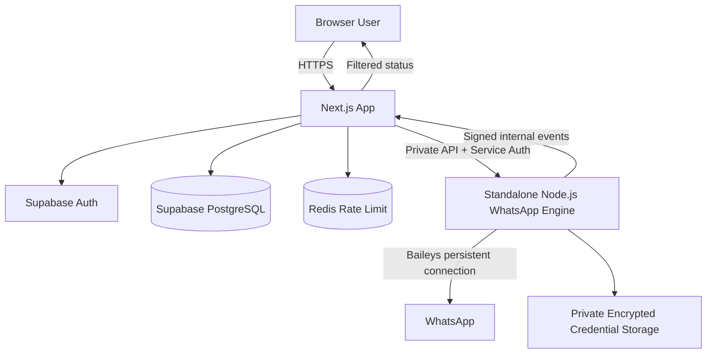

# PRODUCT REQUIREMENTS DOCUMENT (PRD)
# Xevo Web Platform — Secure WhatsApp Engine Integration

**Dokumen:** `PRD_XEVOBOTWA_WEB_PLATFORM.md`  
**Versi:** 1.0 — Draft untuk persetujuan pemilik project  
**Tanggal:** 22 November 2026  
**Referensi:** `ANALISIS_MENDALAM_XEVOBOTWA.md` dan `index.html` (Xevo Bot V2)

---

## 1. Ringkasan Produk

Xevo Web Platform adalah aplikasi web untuk mengelola koneksi WhatsApp yang dimiliki atau secara sah dikuasai pengguna melalui WhatsApp Engine XevoBotWa yang sudah ada.

Platform menyediakan register/login, pairing yang transparan, pemantauan status koneksi, serta pengelolaan session milik pengguna. Prioritas pertama bukan membuat dashboard komersial, melainkan memastikan Engine dapat di-install dan dijalankan secara konsisten, memperbaiki error dependency/startup yang dapat direproduksi, dan menutup temuan keamanan kritis/tinggi. Web application baru dikerjakan setelah Engine melewati gate keamanan dan reliability.

**Tujuan akhir:** aplikasi web yang terhubung ke WhatsApp Engine, alur pairing bekerja pada lingkungan uji yang diotorisasi, session terisolasi per pengguna, dan seluruh proses build/test/deployment terdokumentasi.

> “Siap deploy” berarti kode, konfigurasi, migrasi, pengujian, dokumentasi, dan prosedur deployment sudah disiapkan. Deployment produksi sungguhan tetap membutuhkan kredensial, domain, server, persetujuan pemilik, dan pengujian pada environment yang disediakan.

## 2. Sumber Kebenaran

Agent wajib membaca:
1. `ANALISIS_MENDALAM_XEVOBOTWA.md` sebagai hasil reverse-engineering awal.
2. `index.html` sebagai referensi tampilan dan alur UI Xevo Bot V2.
3. Seluruh source code XevoBotWa yang benar-benar ada di workspace.
4. Log instalasi/runtime lengkap bila tersedia.

Aturan interpretasi:
- Source code dan hasil tes aktual menentukan kondisi implementasi saat ini.
- Dokumen analisis adalah petunjuk awal, bukan kebenaran mutlak.
- Screenshot error di docs/screenshooth-error.jpeg adalah petunjuk, bukan bukti akar masalah.
- `index.html` adalah referensi visual, bukan spesifikasi keamanan yang harus disalin.
- Tandai temuan sebagai **Terverifikasi**, **Indikasi**, **Rekomendasi**, atau **Belum diketahui**.
- Jangan mengarang endpoint, fitur, versi dependency, kapasitas, atau keberhasilan deployment.

## 3. Sasaran dan Prinsip Produk

### Sasaran utama
- Memulihkan Engine agar dapat di-install dan dijalankan secara reproducible.
- Mengamankan pairing, autentikasi, akses session, credentials, dan komunikasi internal.
- Menghubungkan Next.js ke Engine melalui API internal yang terlindungi.
- Memastikan pengguna hanya dapat melihat dan mengelola session miliknya.
- Menyediakan UI yang mudah dipahami, responsif, dan konsisten dengan identitas Xevo.
- Menyediakan automated tests, manual test checklist, logging aman, dan panduan deployment.

### Prinsip engineering
1. Security-first: Engine diamankan sebelum web komersial dibangun.
2. Approval-gated: setiap fase harus direncanakan dan disetujui sebelum implementasi.
3. Incremental delivery: satu fase/scope pada satu waktu.
4. No silent breaking changes: perubahan perilaku wajib dijelaskan.
5. Tenant isolation by design: kepemilikan resource divalidasi di server dan database.
6. Least privilege: setiap service dan role hanya memiliki akses minimum.
7. Consent and transparency: pengguna mengetahui akun apa yang ditautkan dan apa yang akan dilakukan sistem.
8. Maintainability: UI, API, data access, Engine adapter, dan konfigurasi dipisahkan.
9. Evidence-based completion: klaim selesai harus didukung hasil tes atau bukti.

## 4. Scope Produk

### 4.1 Termasuk MVP

**A. Engine**
- Audit ulang struktur dan dependency.
- Diagnosis/perbaikan error install dan startup yang dapat direproduksi.
- Stabilitas lifecycle session dan proses Engine.
- Penghapusan/penonaktifan `eval` dan shell execution berisiko.
- Pengamanan endpoint Engine dan secrets.
- Rate limiting yang konsisten.
- Pengelolaan credentials dan backup aman.
- Kontrak API internal Next.js ↔ Engine.

**B. Web application**
- Landing/entry page.
- Register, login, logout.
- Dashboard pengguna.
- Pairing nomor yang dimiliki/diotorisasi pengguna.
- Pairing code display dan panduan yang jelas.
- Daftar session milik pengguna.
- Detail session dan status yang benar-benar didukung Engine.
- Disconnect/remove session dengan konfirmasi.
- Riwayat aktivitas dasar.
- Admin dashboard minimum untuk health/operasional.
- Loading, empty, error, retry, dan success state.
- UI responsif mobile, tablet, desktop.

**C. Integrasi dan reliability**
- Server-to-server integration Next.js–Engine.
- Health check Engine.
- Status update real-time menggunakan SSE atau pendekatan yang disetujui.
- Logging dan audit trail tanpa secret.
- Test tenant isolation dan otorisasi.
- Environment template dan deployment guide.

### 4.2 Di luar scope MVP

Jangan membangun tanpa PRD/perencanaan dan approval baru:
- Payment gateway, billing, saldo, coin, dan subscription berbayar.
- Reseller/affiliate.
- Otomatisasi mass-follow channel atau mass-join group.
- Penambahan anggota/followers secara massal.
- Broadcast/promotional messaging massal.
- Pengiriman pesan tanpa persetujuan penerima.
- Fitur untuk menghindari pembatasan, deteksi, atau enforcement platform.
- Integrasi WhatsApp Business Platform resmi, kecuali disepakati sebagai perubahan arsitektur.
- Fitur bot baru yang tidak dibutuhkan untuk membuktikan integrasi inti.

Aktivitas yang menyangkut akun harus transparan dan berdasarkan persetujuan eksplisit pemilik akun. Jika fitur tambahan diusulkan, agent harus menjelaskan implikasi teknis, privasi, ketentuan platform, dan risiko sebelum meminta approval.

## 5. Keputusan Tech Stack

| Layer | Teknologi | Tanggung jawab |
|---|---|---|
| Full-stack web | Next.js App Router + TypeScript | UI, Route Handlers/API, server-side business logic |
| Database | Supabase PostgreSQL | Profil, metadata session, konfigurasi, activity/audit logs |
| Authentication | Supabase Auth | Identity, register, login, session |
| Database access | Supabase server-side client | Query dari server, RLS |
| Rate limiting | Redis | Rate limit, temporary locks, TTL state |
| WhatsApp Engine | Existing standalone Node.js process | Baileys, WebSocket persisten, lifecycle session, bot runtime |
| Internal Engine API | Private Node.js HTTP interface | Komunikasi Next.js ke Engine; bukan public API |
| Realtime | SSE sebagai opsi awal | Push status Engine ke UI |
| Hosting | Long-running Node host/VPS untuk Next.js dan Engine; Supabase/Redis managed bila dipilih | Runtime aplikasi |

### 5.1 Keputusan Express.js

Express.js **tidak digunakan sebagai backend web terpisah pada MVP**. Next.js menjadi full-stack application dan menangani API aplikasi melalui Route Handlers.

Namun, ini **tidak berarti Baileys dimasukkan ke proses Next.js**. Engine tetap service Node.js terpisah karena Baileys mempertahankan koneksi WebSocket yang harus hidup terus-menerus.

Internal API Engine dapat menggunakan HTTP server Node.js yang sudah ada. Express hanya boleh ditambahkan jika audit menunjukkan kebutuhan teknis yang nyata dan plan-nya disetujui.

### 5.2 Batas arsitektur wajib

- Browser hanya berkomunikasi dengan Next.js.
- Browser tidak boleh memanggil private Engine API secara langsung.
- Next.js memverifikasi identitas dan hak akses pengguna, lalu mengirim request ke Engine melalui jaringan privat dengan service credential.
- Engine tidak boleh menerima pairing request publik tanpa otorisasi.
- Engine tidak boleh bergantung pada lifecycle serverless function.
- Engine tidak mengirim raw WhatsApp credentials ke Next.js/browser.
- Supabase menyimpan metadata session, bukan credentials WhatsApp dalam plaintext.
- Redis bukan database permanen untuk data utama.
- Supabase Service Role Key, Redis secret, Engine API secret, dan encryption key tidak boleh masuk client bundle.

### 5.3 Arsitektur target



## 6. Alur Produk Utama

### 6.1 Authentication
1. Pengguna register/login.
2. Server memvalidasi session Supabase Auth.
3. Setiap request privat mendapatkan identitas yang valid.
4. Query session dibatasi berdasarkan user identity dan diperkuat RLS.
5. Pengguna dapat logout dan session dicabut sesuai mekanisme auth.

Guest access panel lama tidak boleh otomatis dibawa ke MVP. Jika guest access diusulkan, agent harus menjelaskan ancaman dan meminta approval.

### 6.2 Pairing
1. Pengguna membuka halaman Pair WhatsApp.
2. Sistem menjelaskan bahwa nomor harus milik pengguna atau pengguna memiliki otorisasi yang sah.
3. UI menjelaskan kemampuan dan risiko penggunaan Engine berbasis Baileys yang tidak resmi.
4. Pengguna memberi persetujuan eksplisit terhadap tindakan yang akan dijalankan.
5. Pengguna memasukkan nomor; validasi dilakukan di client dan server.
6. Next.js memverifikasi authentication, otorisasi, batas penggunaan, dan rate limit Redis.
7. Next.js mengirim request ke Engine melalui private authenticated API.
8. Engine menghasilkan pairing code dan mengembalikan hasil minimum yang diperlukan.
9. Pairing code ditampilkan sementara dengan batas waktu. Jangan menulisnya ke log.
10. UI menampilkan petunjuk Linked Devices.
11. Engine mengirim status perubahan koneksi.
12. Next.js memperbarui metadata session milik user yang benar.
13. UI menampilkan status aktual.

Aturan:
- Jangan pairing nomor pihak lain tanpa otorisasi.
- Jangan melakukan pairing nyata pada nomor produksi selama development tanpa instruksi eksplisit.
- Jangan menyimpan pairing code secara permanen.
- Pairing code tidak boleh dapat dilihat user lain, admin umum, log, atau analytics.
- UI harus menjelaskan cara unlink dari WhatsApp dan menghapus session dari platform.
- Auto-follow tersembunyi dari Engine lama harus nonaktif secara default. Tindakan lanjutan harus ditampilkan dan memerlukan consent terpisah; mass-follow bukan bagian MVP.

### 6.3 Session management
Pengguna hanya dapat:
- Melihat session miliknya.
- Melihat nomor yang dimasking pada daftar.
- Melihat status dan waktu koneksi.
- Melihat aktivitas dasar miliknya.
- Disconnect atau menghapus session miliknya dengan konfirmasi.
- Melihat pesan error aman dan instruksi pemulihan.

Aksi admin harus dibatasi role, tercatat, dan tidak memberi akses membaca credentials.

## 7. Data Model Awal

Model final wajib dirancang dan disetujui sebelum migration.

| Tabel | Kolom inti | Catatan |
|---|---|---|
| `profiles` | `id`, `display_name`, `role`, `created_at`, `updated_at` | `id` terhubung ke Supabase Auth user ID; user tidak boleh menaikkan role sendiri |
| `whatsapp_sessions` | `id`, `user_id`, `phone_masked`, `phone_lookup_hash`, `status`, `engine_session_ref`, `connected_at`, `disconnected_at`, timestamps | Metadata saja; bukan raw credentials |
| `bot_configurations` | `id`, `user_id`, `session_id`, `prefix`, `enabled_features`, `updated_at` | Terikat ke pemilik session |
| `activity_logs` | `id`, `user_id`, `session_id`, `event_type`, `safe_metadata`, `created_at` | Tidak boleh memuat credentials, pairing code, token, atau pesan pribadi |
| `admin_audit_logs` | `id`, `actor_user_id`, `action`, `target_type`, `target_id`, `safe_metadata`, `created_at` | Catat aksi admin penting |

Subscription/payment tidak termasuk MVP dan hanya boleh ditambahkan melalui fase/PRD tersendiri.

### 7.1 Row Level Security
- Aktifkan RLS pada seluruh tabel user data.
- User hanya dapat membaca/mengubah resource miliknya.
- Role admin ditentukan melalui sumber otoritatif yang aman.
- Service Role key hanya dipakai server.
- Jangan mengandalkan filter UI sebagai kontrol akses.
- Tambahkan tes yang membuktikan User A tidak bisa membaca, mengubah, atau menghapus resource User B.

### 7.2 WhatsApp credentials
- Raw credentials tidak boleh disimpan pada tabel metadata atau dikirim ke browser.
- Credentials disimpan Engine dalam private storage, di luar public web root.
- Rencanakan enkripsi at-rest dengan authenticated encryption (misalnya AES-256-GCM) setelah memastikan kompatibilitas lifecycle Baileys.
- Encryption master key disimpan di environment/secret manager.
- Akses file hanya diberikan kepada service account Engine.
- Backup terenkripsi, akses terbatas, prosedur restore diuji.
- Jika penyimpanan aman belum diterapkan, pairing production harus diblokir.

## 8. Security Requirements

Temuan berikut berasal dari audit awal dan harus diverifikasi ulang pada source code terkini.

| ID | Temuan awal | Prioritas | Kriteria penyelesaian |
|---|---|---|---|
| SEC-01 | `eval()` tanpa sandbox pada `Xevo.js` | Critical | Dihapus/dinonaktifkan; tidak ada arbitrary code execution |
| SEC-02 | `exec()` shell command pada `Xevo.js` | Critical | Dihapus/dinonaktifkan; tidak diganti arbitrary shell execution |
| SEC-03 | Pairing endpoint tanpa auth | High | Wajib authenticated user, authorization, rate limit, ownership binding |
| SEC-04 | Session list publik | High | Tidak ada endpoint publik yang mengembalikan semua session |
| SEC-05 | Dashboard stats terbuka | Medium | Statistik sistem hanya untuk admin |
| SEC-06 | Token di Map in-memory | Medium | Web auth melalui Supabase Auth; internal service auth punya rotasi |
| SEC-07 | JSON files sebagai database | Medium | Metadata aplikasi dimigrasi terencana ke Supabase PostgreSQL |
| SEC-08 | `ownerNumber` dalam `config.json` | Medium | Konfigurasi sensitif dipindah ke env/secret management |
| SEC-09 | Auto-follow tanpa consent | Medium | Dinonaktifkan default; tindakan memerlukan consent terpisah |
| SEC-10 | Tidak ada CSRF protection | Medium | Proteksi sesuai strategi cookie/auth dan diuji |
| SEC-11 | Rate limit IP-only/in-memory | Medium | Redis-backed rate limit per IP dan user/resource |
| SEC-12 | `auth/` dan `database/` belum di `.gitignore` | High | Runtime data di-ignore; audit tracked files/history sebelum release |
| SEC-13 | `.public`/`.self` dapat diubah siapa saja | Medium | Role/permission divalidasi pada Engine |
| SEC-14 | Input validation minim | Medium | Schema validation server-side, request size limit, tipe dan format tervalidasi |
| SEC-15 | Image proxy/redirect berisiko | Low/Medium | Batasi host dan validasi URL tujuan akhir, atau nonaktifkan bila tak dibutuhkan |

Kontrol tambahan:
- CORS allowlist bila diperlukan.
- Secure, HttpOnly, SameSite cookies sesuai auth strategy.
- CSRF protection untuk mutation berbasis cookie.
- Zod atau schema validator sejenis pada request boundary.
- Rate limit untuk login, pairing, session actions, dan endpoint sensitif.
- Timeout, request size limit, error handling, dan safe error messages.
- Audit log untuk pairing, disconnect, delete, role change, dan admin action.
- Masking nomor dan redaction secrets.
- Secret scanning dan dependency audit.
- Dependency version pinning dan lockfile konsisten.
- Jangan expose debug stack trace kepada client.
- Jangan percaya user ID, role, owner, atau status yang dikirim browser.

**Go-live gate:** tidak boleh ada temuan Critical/High yang belum ditangani atau secara tertulis diterima risikonya oleh pemilik project. Risiko penggunaan library tidak resmi juga wajib ditinjau sebelum layanan dibuka ke publik/komersial.

## 9. Engine Reliability dan Dependency

Dari analisis awal:
- `package.json` menyebut Node.js `>=22.12.0`; verifikasi ulang kondisi aktual.
- Baileys di-alias ke fork `nachles@latest`.
- Screenshot menunjukkan `npm ERR! ERESOLVE unable to resolve dependency tree`.
- `start.js` menjalankan server dan Cloudflare Quick Tunnel ke port 5004.
- Quick Tunnel menghasilkan hostname sementara yang dapat berubah saat restart.
- Ada indikasi launcher memiliki ketergantungan platform Linux.
- Beberapa dependency disebut tidak digunakan; verifikasi sebelum penghapusan.

Kriteria:
1. Verifikasi Node version, package manager, lockfile, dependency graph, OS, dan log lengkap.
2. Identifikasi dependency yang benar-benar menyebabkan ERESOLVE.
3. Jangan menggunakan `--force` atau `--legacy-peer-deps` sebagai default.
4. Jangan mengganti fork Baileys tanpa analisis kompatibilitas dan approval.
5. Jangan menggunakan `@latest` secara membabi buta pada production dependency.
6. Jalankan install reproducible (`npm ci` bila menggunakan npm).
7. Uji import, startup, graceful shutdown, health check, reconnect lifecycle.
8. Pisahkan start Engine dari tunnel. Tunnel bukan syarat Engine berjalan.
9. Gunakan domain/named tunnel atau reverse proxy pada deployment; Quick Tunnel hanya development/temporary.
10. Gunakan process manager/service manager untuk Engine.
11. Uji backup dan restore credentials terenkripsi.
12. Jangan menyatakan pairing normal hanya karena Node process tidak crash.

## 10. UI/UX Requirements

### 10.1 Referensi visual `index.html`
Pertahankan karakter desain Xevo yang relevan:
- Nuansa dark interface.
- Aksen merah/Spider-inspired Xevo yang terlihat di stylesheet.
- Tipografi tegas untuk judul.
- Card dengan border tegas dan depth/shadow.
- Status badge jelas.
- Pairing sebagai tindakan utama.
- Layout ringkas dan mudah dipahami.

`index.html` berisi beberapa layer tema yang saling override. Agent wajib menentukan visual akhir yang konsisten, lalu membangun ulang dengan design tokens dan reusable components. Jangan menyalin CSS monolitik atau mencampur semua tema sekaligus.

### 10.2 Prinsip UX
- User-friendly, jelas, tidak membuat pengguna menebak fungsi tombol.
- Bahasa Indonesia untuk UI utama.
- Hindari jargon tanpa penjelasan.
- Label, helper text, validasi inline, dan error message harus memberi tahu langkah berikutnya.
- Konfirmasi untuk tindakan destruktif.
- Status ditampilkan dengan teks dan indikator, bukan warna saja.
- Pairing flow: input nomor → persetujuan → generate code → instruksi → menunggu koneksi → hasil.
- Jangan tampilkan pairing code sebelum request berhasil.
- Jangan tampilkan status Online secara hardcoded; ambil dari health check aktual.
- Sediakan loading/skeleton, empty, error, retry, dan success state.
- Responsive mobile/tablet/desktop.
- Aksesibilitas: kontras, keyboard navigation, focus states, semantic HTML, target sentuh memadai.

### 10.3 Halaman MVP

| Halaman | Kebutuhan |
|---|---|
| `/` | Landing/entry, ringkasan, CTA |
| `/login` | Login |
| `/register` | Register |
| `/dashboard` | Ringkasan akun dan status Engine/session milik user |
| `/dashboard/pairing` | Form dan proses pairing |
| `/dashboard/sessions` | Daftar session milik user |
| `/dashboard/sessions/[id]` | Detail dan aksi yang diizinkan |
| `/dashboard/activity` | Aktivitas akun dasar |
| `/admin` | Health/operasional terbatas untuk admin |

Route final dapat disesuaikan hanya setelah disebut dalam plan dan disetujui.

## 11. API dan Integrasi

### 11.1 Kandidat public application API (Next.js)
- `POST /api/pairing`
- `GET /api/sessions`
- `GET /api/sessions/:id`
- `POST /api/sessions/:id/disconnect`
- `DELETE /api/sessions/:id`
- `GET /api/engine/health` (admin/internal policy)
- `GET /api/events` atau SSE stream terautentikasi

Ini rancangan, bukan pernyataan bahwa endpoint tersebut sudah ada.

### 11.2 Kandidat private Engine API
- `GET /internal/health`
- `POST /internal/sessions/pair`
- `GET /internal/sessions/:engineSessionRef`
- `POST /internal/sessions/:engineSessionRef/disconnect`
- `DELETE /internal/sessions/:engineSessionRef`
- Signed internal status/event callback

Kontrak final dibuat pada fase perencanaan integrasi. Jangan expose private Engine API ke browser.

### 11.3 Service-to-service security
- Gunakan private network/localhost binding jika satu host.
- Jika lintas host, gunakan TLS dan service authentication dengan secret/HMAC yang dapat dirotasi.
- Validasi signature/timestamp dan cegah replay pada callback penting.
- Gunakan timeout dan retry terkendali.
- Jangan retry pairing secara membabi buta.
- Gunakan idempotency key untuk operasi yang rawan duplikasi.
- Jangan log pairing code atau credentials.

## 12. Reliability, Observability, Backup
- Health check membedakan process alive dan WhatsApp connection healthy.
- Status di web bersumber dari pemeriksaan aktual.
- Log terstruktur dengan correlation ID.
- Redact nomor, credentials, pairing code, access token, cookies, dan secrets.
- Catat reconnect count dan error category tanpa secret.
- Timeout dan graceful shutdown.
- Uji restart tanpa kehilangan metadata penting.
- Backup credentials terenkripsi dan database.
- Uji prosedur restore.
- Dokumentasikan RPO/RTO realistis setelah lingkungan operasional diketahui.

## 13. Testing dan Acceptance Criteria

### 13.1 Engine Gate — wajib sebelum web build
- [ ] Install reproducible dari lockfile.
- [ ] `npm ci` atau perintah setara berhasil pada target environment.
- [ ] Engine start/shutdown dengan benar.
- [ ] Startup tidak membutuhkan Cloudflare Quick Tunnel.
- [ ] Health check akurat.
- [ ] Tidak ada arbitrary eval/shell execution.
- [ ] Endpoint Engine tidak bisa diakses publik.
- [ ] Pairing endpoint memerlukan otorisasi.
- [ ] Session list tidak membocorkan tenant lain.
- [ ] Credentials tidak masuk Git, response, atau log.
- [ ] Rate limit teruji.
- [ ] Owner-only command tervalidasi di Engine.
- [ ] Auto-follow tersembunyi dinonaktifkan.
- [ ] Risiko fork/lisensi dicatat.
- [ ] Tes memakai mock atau nomor uji berizin.

### 13.2 Web Gate
- [ ] Register/login/logout berfungsi.
- [ ] Auth server-side diverifikasi.
- [ ] RLS aktif dan diuji.
- [ ] User A tidak dapat membaca/mengubah/menghapus resource User B.
- [ ] Pairing melalui Next.js mencapai Engine dengan private auth.
- [ ] Pairing code tidak tersimpan permanen atau bocor ke log.
- [ ] Status session tersinkron akurat.
- [ ] Disconnect/delete hanya untuk owner/admin yang sah.
- [ ] Redis rate limit bekerja lintas request/proses.
- [ ] Semua UI states tersedia.
- [ ] UI responsive dan keyboard accessible.
- [ ] Error tidak membeberkan stack trace/secret.
- [ ] API, integration, dan E2E test lulus.

### 13.3 Deployment Gate
- [ ] `.env.example` tanpa secret.
- [ ] Migration/seed instructions tersedia.
- [ ] Next.js dan Engine berjalan sebagai service terpisah.
- [ ] Domain/TLS dapat dikonfigurasi.
- [ ] Engine tidak terbuka langsung ke public internet.
- [ ] Process manager/auto-restart disiapkan.
- [ ] Backup/restore diuji.
- [ ] Health checks/monitoring tersedia.
- [ ] Production build dan smoke tests lulus.
- [ ] Rollback plan tersedia.
- [ ] Risiko kebijakan/lisensi ditinjau sebelum commercial launch.

## 14. Tahapan Pengerjaan dan Approval Gates

Setiap fase memiliki dua langkah: (A) plan dahulu dan berhenti; (B) setelah pemilik mengirim approval eksplisit, implementasikan fase tersebut. Selesai implementasi **bukan** izin otomatis untuk melanjutkan.

| Fase | Nama | Fokus | Output minimum |
|---|---|---|---|
| 0 | Discovery & Remediation Plan | Audit source aktual, diagnosis ERESOLVE/startup, verifikasi security findings, rencana perbaikan | `docs/plans/PHASE-0-DISCOVERY-AND-REMEDIATION.md` |
| 1 | Engine Runtime Recovery | Dependency, startup, lifecycle proses, health check | Laporan runtime test |
| 2 | Engine Security Hardening | Critical/high security, internal API, credentials, permissions, rate limit | Security remediation report |
| 3 | Integration Contract & Architecture | Kontrak Next ↔ Engine, ownership, Supabase/RLS, Redis, event transport | Architecture decision + API contract |
| 4 | Web Foundation | Next.js, Supabase Auth, DB migrations, design tokens, layout shell | Foundation lulus test |
| 5 | Core User Flows | Auth, dashboard, pairing, session list/detail, disconnect/delete | Core flow berjalan |
| 6 | Admin & Operational UX | Admin minimum, health/status, activity logs | Ops workflow |
| 7 | Integration QA & Security QA | E2E, tenant isolation, rate limit, pairing lifecycle | QA report + residual risks |
| 8 | Production Readiness | Build, deployment guide, env, monitoring, backup/restore, rollback | Release checklist |

Fase 1 dan 2 wajib selesai serta disetujui sebelum fase 3–8 dimulai. Jika Engine tidak aman/kompatibel untuk tujuan yang dituju, berhenti dan jelaskan blocker serta alternatif.

### 14.1 Prosedur approval
Sebelum setiap fase:
1. Baca status fase sebelumnya.
2. Buat plan terperinci.
3. Daftarkan file yang akan dibuat/diubah/dihapus.
4. Sebutkan perintah, migration, test, risiko, dan rollback.
5. Jelaskan keputusan yang memerlukan pemilik.
6. **Berhenti dan tunggu approval** dengan format `APPROVE PHASE-X`.

Setelah approval:
1. Kerjakan hanya scope fase.
2. Jalankan test sesuai plan.
3. Laporkan file berubah, hasil tes, risiko tersisa, dan rollback.
4. Jangan mulai fase berikutnya.
5. Buat plan fase selanjutnya dan tunggu approval baru.

Ucapan umum seperti “oke” atau “lanjut” tidak otomatis menjadi approval jika fase yang disetujui tidak jelas. Jika scope berubah, minta approval ulang.

## 15. Aturan WAJIB Dilakukan

1. Audit source aktual sebelum perubahan.
2. Gunakan branch/commit/backup yang dapat dipulihkan.
3. Pertahankan behavior bot yang sah dan masih diperlukan kecuali disetujui untuk diubah.
4. Catat alasan perubahan pada fungsi sensitif.
5. Pin dependency dan pertahankan lockfile.
6. Gunakan TypeScript untuk kode Next.js baru.
7. Gunakan Supabase RLS dan server-side authorization.
8. Terapkan Redis rate limiting pada aksi sensitif.
9. Validasi server-side semua input.
10. Buat komponen UI reusable dan design tokens.
11. Pastikan data session tidak bocor lintas user.
12. Berikan error informatif tanpa detail internal.
13. Sediakan test dan dokumentasi untuk setiap fase.
14. Gunakan test double/mock atau nomor uji berizin.
15. Laporkan asumsi, blocker, serta residual risk.
16. Hentikan pekerjaan saat approval gate belum dilewati.

## 16. Aturan DILARANG Dilakukan

1. Dilarang mengerjakan semua fase sekaligus.
2. Dilarang melanjutkan tanpa approval eksplisit per fase.
3. Dilarang mengubah kode pada fase yang hanya meminta plan.
4. Dilarang menghapus file, dependency, atau fitur tanpa analisis dan persetujuan.
5. Dilarang memakai `--force`/`--legacy-peer-deps` sebagai jalan pintas tanpa diagnosis dan approval.
6. Dilarang mengganti fork Baileys atau menggunakan `latest` secara membabi buta.
7. Dilarang memindahkan koneksi Baileys persisten ke Next.js serverless function.
8. Dilarang membuka Engine internal API kepada browser/public internet.
9. Dilarang menyimpan credentials, token, pairing code, atau secrets sebagai plaintext di DB/log/repository.
10. Dilarang mengirim Supabase service key atau Redis secret ke client.
11. Dilarang mempercayai `user_id`, role, atau ownership dari browser.
12. Dilarang membiarkan pairing endpoint/session list tanpa authorization.
13. Dilarang menjalankan pairing nyata tanpa izin pemilik nomor dan pemilik project.
14. Dilarang melakukan auto-follow tersembunyi, mass-follow, mass-join, spam messaging, manipulasi engagement, atau penghindaran enforcement.
15. Dilarang menyembunyikan tindakan yang dilakukan pada akun WhatsApp pengguna.
16. Dilarang mengklaim “secure”, “fully tested”, atau “production ready” tanpa bukti.
17. Dilarang menghilangkan identitas visual Xevo dengan template generik.
18. Dilarang membuat payment/subscription sebelum core Engine–Web integration selesai dan disetujui.

## 17. Dokumentasi Wajib

```text
docs/
├── PRD_XEVOBOTWA_WEB_PLATFORM.md
├── architecture/
│   ├── SYSTEM_ARCHITECTURE.md
│   ├── ENGINE_INTEGRATION_CONTRACT.md
│   └── DATABASE_SCHEMA.md
├── plans/
│   ├── PHASE-0-DISCOVERY-AND-REMEDIATION.md
│   └── ...
├── security/
│   ├── SECURITY_REMEDIATION_REPORT.md
│   └── RESIDUAL_RISK_REGISTER.md
├── testing/
│   ├── TEST_STRATEGY.md
│   └── RELEASE_TEST_REPORT.md
└── deployment/
    ├── DEPLOYMENT_GUIDE.md
    ├── ENVIRONMENT_VARIABLES.md
    ├── BACKUP_RESTORE.md
    └── ROLLBACK.md
```

Jangan menghapus atau menimpa dokumen referensi tanpa persetujuan.

## 18. Definition of Done

Project dinyatakan memenuhi PRD ketika:
- Engine dapat di-install dan dijalankan secara reproducible pada target environment.
- Temuan Critical/High ditangani dan residual risk terdokumentasi.
- Next.js terhubung ke Engine melalui private authenticated API.
- Supabase PostgreSQL menyimpan data aplikasi dan RLS melindungi tenant.
- Redis rate limiting aktif dan diuji.
- User bisa login, pairing dengan otorisasi, memantau status, dan mengelola session sendiri.
- Tidak ada kebocoran credentials atau data lintas tenant pada test.
- UI konsisten dengan referensi Xevo, responsif, dan mudah dipahami.
- Build, automated, integration, dan smoke tests lulus.
- Deployment, env, backup/restore, monitoring, dan rollback terdokumentasi.
- Semua fase mendapatkan approval pemilik project.
- Risiko Baileys, lisensi, kebijakan platform, dan operasional tidak disembunyikan.

## 19. Catatan Risiko Produk

Analisis awal menyebut project menggunakan fork Baileys (`nachles`) dan bukan WhatsApp Business Platform resmi. Protokol dapat berubah, kompatibilitas fork dapat rusak, dan penggunaan library tidak resmi memiliki risiko pembatasan akun/layanan.

Sebelum layanan dibuka untuk publik/komersial:
- Verifikasi kepemilikan serta lisensi source code dasar dan fork.
- Tinjau ketentuan platform yang berlaku.
- Pertimbangkan WhatsApp Business Platform resmi bila stabilitas, dukungan resmi, dan penggunaan komersial menjadi persyaratan.
- Jangan menjanjikan uptime atau hasil akun/followers yang tidak dapat dikendalikan platform.

**Akhir PRD.**
