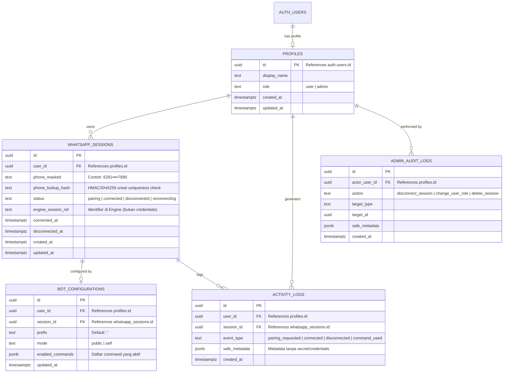

# DATABASE SCHEMA & ROW LEVEL SECURITY (RLS)

> **Dokumen:** `docs/architecture/DATABASE_SCHEMA.md`  
> **Versi:** 1.0  
> **Status:** Architecture Reference (Phase 3)  
> **Target Database:** Supabase PostgreSQL

---

## 1. Entity-Relationship Diagram (ERD)



---

## 2. PostgreSQL DDL Migration Script

Skrip SQL berikut siap dieksekusi di Supabase SQL Editor pada saat implementasi Phase 4.

```sql
-- ============================================================================
-- 1. EXTENSIONS & UTILITIES
-- ============================================================================
CREATE EXTENSION IF NOT EXISTS "uuid-ossp";

-- Fungsi trigger update timestamp otomatis
CREATE OR REPLACE FUNCTION public.handle_updated_at()
RETURNS TRIGGER AS $$
BEGIN
    NEW.updated_at = NOW();
    RETURN NEW;
END;
$$ LANGUAGE plpgsql;

-- ============================================================================
-- 2. TABEL: PROFILES
-- ============================================================================
CREATE TABLE public.profiles (
    id UUID PRIMARY KEY REFERENCES auth.users(id) ON DELETE CASCADE,
    display_name TEXT NOT NULL,
    role TEXT NOT NULL DEFAULT 'user' CHECK (role IN ('user', 'admin')),
    created_at TIMESTAMPTZ NOT NULL DEFAULT NOW(),
    updated_at TIMESTAMPTZ NOT NULL DEFAULT NOW()
);

CREATE TRIGGER set_profiles_updated_at
BEFORE UPDATE ON public.profiles
FOR EACH ROW EXECUTE FUNCTION public.handle_updated_at();

-- Auto-create profile saat user mendaftar di Supabase Auth
CREATE OR REPLACE FUNCTION public.handle_new_user()
RETURNS TRIGGER AS $$
BEGIN
    INSERT INTO public.profiles (id, display_name, role)
    VALUES (
        NEW.id,
        COALESCE(NEW.raw_user_meta_data->>'full_name', NEW.raw_user_meta_data->>'name', 'Pengguna Xevo'),
        'user'
    );
    RETURN NEW;
END;
$$ LANGUAGE plpgsql SECURITY DEFINER;

CREATE TRIGGER on_auth_user_created
AFTER INSERT ON auth.users
FOR EACH ROW EXECUTE FUNCTION public.handle_new_user();

-- ============================================================================
-- 3. TABEL: WHATSAPP_SESSIONS
-- ============================================================================
CREATE TABLE public.whatsapp_sessions (
    id UUID PRIMARY KEY DEFAULT uuid_generate_v4(),
    user_id UUID NOT NULL REFERENCES public.profiles(id) ON DELETE CASCADE,
    phone_masked TEXT NOT NULL,
    phone_lookup_hash TEXT NOT NULL,
    status TEXT NOT NULL DEFAULT 'pairing' CHECK (status IN ('pairing', 'connected', 'disconnected', 'reconnecting')),
    engine_session_ref TEXT NOT NULL,
    connected_at TIMESTAMPTZ,
    disconnected_at TIMESTAMPTZ,
    created_at TIMESTAMPTZ NOT NULL DEFAULT NOW(),
    updated_at TIMESTAMPTZ NOT NULL DEFAULT NOW()
);

CREATE INDEX idx_whatsapp_sessions_user_id ON public.whatsapp_sessions(user_id);
CREATE INDEX idx_whatsapp_sessions_status ON public.whatsapp_sessions(status);
CREATE INDEX idx_whatsapp_sessions_phone_hash ON public.whatsapp_sessions(phone_lookup_hash);

CREATE TRIGGER set_whatsapp_sessions_updated_at
BEFORE UPDATE ON public.whatsapp_sessions
FOR EACH ROW EXECUTE FUNCTION public.handle_updated_at();

-- ============================================================================
-- 4. TABEL: BOT_CONFIGURATIONS
-- ============================================================================
CREATE TABLE public.bot_configurations (
    id UUID PRIMARY KEY DEFAULT uuid_generate_v4(),
    user_id UUID NOT NULL REFERENCES public.profiles(id) ON DELETE CASCADE,
    session_id UUID NOT NULL REFERENCES public.whatsapp_sessions(id) ON DELETE CASCADE,
    prefix TEXT NOT NULL DEFAULT '.',
    mode TEXT NOT NULL DEFAULT 'public' CHECK (mode IN ('public', 'self')),
    enabled_commands JSONB NOT NULL DEFAULT '["menu", "dadu", "koin", "suit", "catur", "flappy", "ping"]'::jsonb,
    updated_at TIMESTAMPTZ NOT NULL DEFAULT NOW(),
    CONSTRAINT uq_session_config UNIQUE (session_id)
);

CREATE TRIGGER set_bot_configurations_updated_at
BEFORE UPDATE ON public.bot_configurations
FOR EACH ROW EXECUTE FUNCTION public.handle_updated_at();

-- ============================================================================
-- 5. TABEL: ACTIVITY_LOGS
-- ============================================================================
CREATE TABLE public.activity_logs (
    id UUID PRIMARY KEY DEFAULT uuid_generate_v4(),
    user_id UUID NOT NULL REFERENCES public.profiles(id) ON DELETE CASCADE,
    session_id UUID REFERENCES public.whatsapp_sessions(id) ON DELETE SET NULL,
    event_type TEXT NOT NULL,
    safe_metadata JSONB DEFAULT '{}'::jsonb,
    created_at TIMESTAMPTZ NOT NULL DEFAULT NOW()
);

CREATE INDEX idx_activity_logs_user_id ON public.activity_logs(user_id);
CREATE INDEX idx_activity_logs_created_at ON public.activity_logs(created_at DESC);

-- ============================================================================
-- 6. TABEL: ADMIN_AUDIT_LOGS
-- ============================================================================
CREATE TABLE public.admin_audit_logs (
    id UUID PRIMARY KEY DEFAULT uuid_generate_v4(),
    actor_user_id UUID NOT NULL REFERENCES public.profiles(id) ON DELETE RESTRICT,
    action TEXT NOT NULL,
    target_type TEXT NOT NULL,
    target_id UUID,
    safe_metadata JSONB DEFAULT '{}'::jsonb,
    created_at TIMESTAMPTZ NOT NULL DEFAULT NOW()
);

CREATE INDEX idx_admin_audit_logs_actor ON public.admin_audit_logs(actor_user_id);
```

---

## 3. Kebijakan Row Level Security (RLS)

Kebijakan ini menjamin bahwa **User A tidak akan pernah bisa membaca, mengubah, atau menghapus sesi milik User B**, bahkan jika terjadi manipulasi parameter di sisi client.

```sql
-- Aktifkan RLS di seluruh tabel
ALTER TABLE public.profiles ENABLE ROW LEVEL SECURITY;
ALTER TABLE public.whatsapp_sessions ENABLE ROW LEVEL SECURITY;
ALTER TABLE public.bot_configurations ENABLE ROW LEVEL SECURITY;
ALTER TABLE public.activity_logs ENABLE ROW LEVEL SECURITY;
ALTER TABLE public.admin_audit_logs ENABLE ROW LEVEL SECURITY;

-- Helper function: Cek apakah user adalah admin
CREATE OR REPLACE FUNCTION public.is_admin()
RETURNS BOOLEAN AS $$
BEGIN
    RETURN EXISTS (
        SELECT 1 FROM public.profiles
        WHERE id = auth.uid() AND role = 'admin'
    );
END;
$$ LANGUAGE plpgsql SECURITY DEFINER;

-- ----------------------------------------------------------------------------
-- RLS POLICIES: PROFILES
-- ----------------------------------------------------------------------------
CREATE POLICY "Users can read own profile"
ON public.profiles FOR SELECT
USING (auth.uid() = id OR public.is_admin());

CREATE POLICY "Users can update own display_name only"
ON public.profiles FOR UPDATE
USING (auth.uid() = id)
WITH CHECK (auth.uid() = id AND role = (SELECT role FROM public.profiles WHERE id = auth.uid()));

-- ----------------------------------------------------------------------------
-- RLS POLICIES: WHATSAPP_SESSIONS
-- ----------------------------------------------------------------------------
CREATE POLICY "Users can read own sessions"
ON public.whatsapp_sessions FOR SELECT
USING (auth.uid() = user_id OR public.is_admin());

CREATE POLICY "Users can insert own sessions"
ON public.whatsapp_sessions FOR INSERT
WITH CHECK (auth.uid() = user_id);

CREATE POLICY "Users can update own sessions"
ON public.whatsapp_sessions FOR UPDATE
USING (auth.uid() = user_id)
WITH CHECK (auth.uid() = user_id);

CREATE POLICY "Users can delete own sessions"
ON public.whatsapp_sessions FOR DELETE
USING (auth.uid() = user_id OR public.is_admin());

-- ----------------------------------------------------------------------------
-- RLS POLICIES: BOT_CONFIGURATIONS
-- ----------------------------------------------------------------------------
CREATE POLICY "Users can manage own bot configurations"
ON public.bot_configurations FOR ALL
USING (auth.uid() = user_id OR public.is_admin())
WITH CHECK (auth.uid() = user_id);

-- ----------------------------------------------------------------------------
-- RLS POLICIES: ACTIVITY_LOGS
-- ----------------------------------------------------------------------------
CREATE POLICY "Users can read own activity logs"
ON public.activity_logs FOR SELECT
USING (auth.uid() = user_id OR public.is_admin());

CREATE POLICY "System can insert activity logs"
ON public.activity_logs FOR INSERT
WITH CHECK (auth.uid() = user_id);

-- ----------------------------------------------------------------------------
-- RLS POLICIES: ADMIN_AUDIT_LOGS
-- ----------------------------------------------------------------------------
CREATE POLICY "Admins only can read audit logs"
ON public.admin_audit_logs FOR SELECT
USING (public.is_admin());

CREATE POLICY "Admins only can insert audit logs"
ON public.admin_audit_logs FOR INSERT
WITH CHECK (public.is_admin());
```

---

## 4. Keamanan Kredensial WhatsApp (Database Isolation)

Perhatikan bahwa tabel `whatsapp_sessions` di atas **hanya menyimpan**:
- `phone_masked` (contoh: `6281••••7890`)
- `phone_lookup_hash` (hash satu arah untuk mendeteksi nomor ganda)
- `engine_session_ref` (referensi folder sesi di Engine lokal)

Kunci privat Noise Protocol, WhatsApp auth keys, dan file `creds.json` **TIDAK PERNAH DISIMPAN DI DATABASE SUPABASE**. Kunci kriptografi tersebut tetap berada secara lokal di server Engine dalam direktori yang diisolasi.
