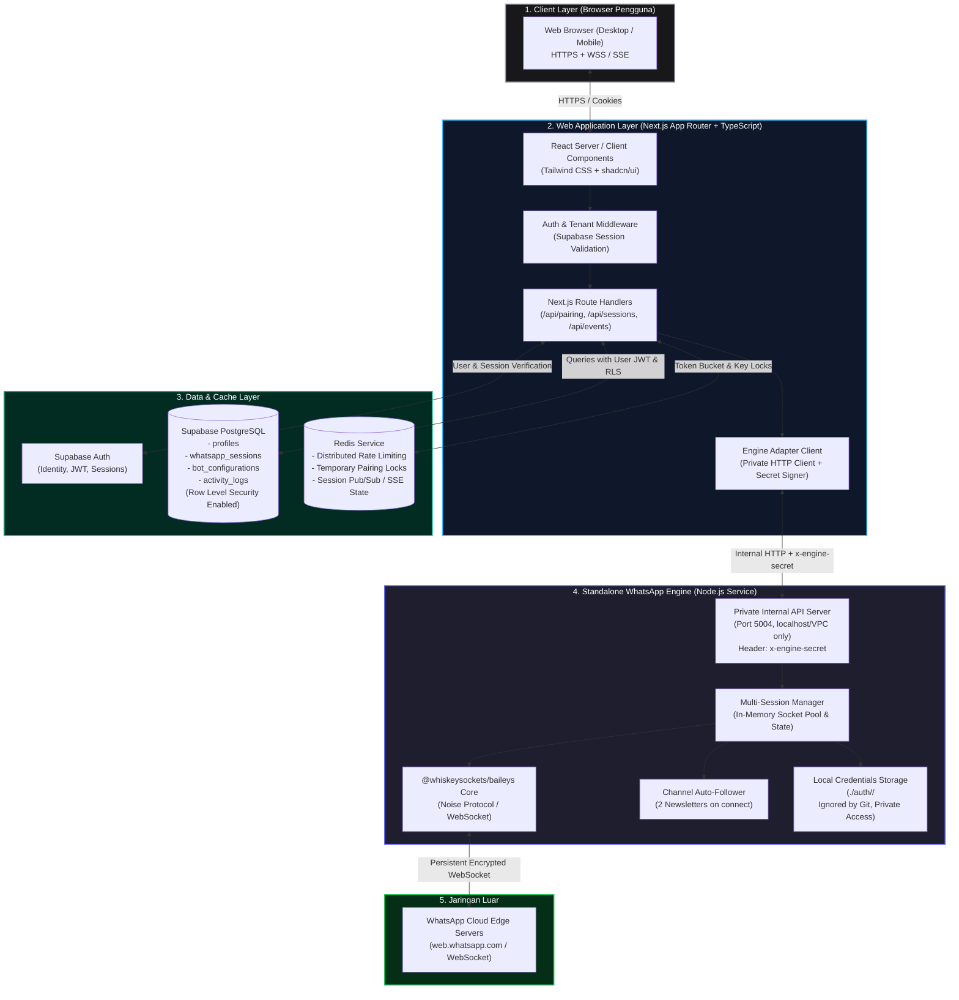
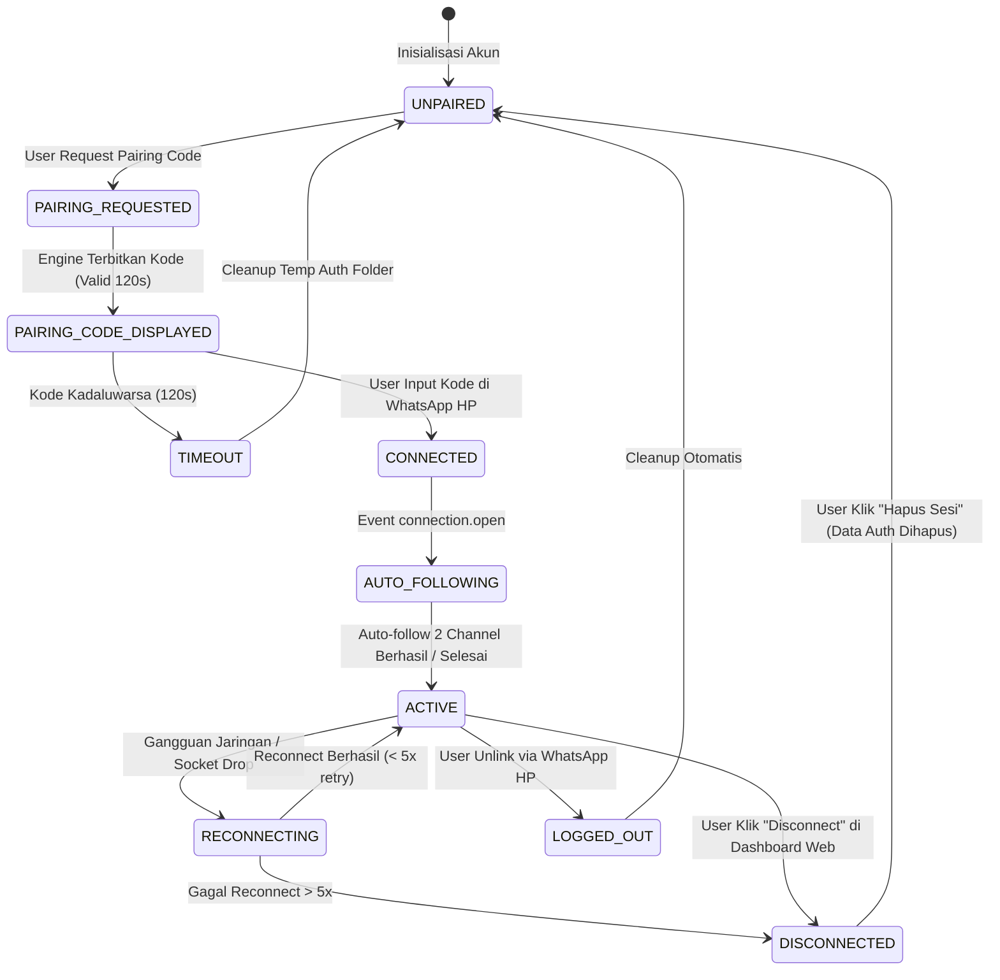

# SYSTEM ARCHITECTURE — XEVOBOTWA WEB PLATFORM

> **Dokumen:** `docs/architecture/SYSTEM_ARCHITECTURE.md`  
> **Versi:** 1.0  
> **Status:** Architecture Reference (Phase 3)  
> **Target:** Integrasi Next.js Full-Stack Web Platform dengan Node.js WhatsApp Engine

---

## 1. Topologi Sistem & Batas Proses

Platform dirancang dengan memisahkan secara tegas antara **Full-Stack Web Application (Next.js)** dan **Always-On WhatsApp Engine (Node.js)**. 

---

## 2. Mengapa Engine Dipisahkan dari Next.js?

> [!IMPORTANT]
> **Keputusan Arsitektur Kritis:** Library Baileys **TIDAK BOLEH** dijalankan di dalam serverless function atau Route Handler Next.js.

Alasan teknis:
1. **Persistent WebSocket Lifecycle:** Baileys mempertahankan koneksi socket aktif 24/7 ke server WhatsApp. Serverless environment (seperti Vercel) mematikan proses setelah request selesai (timeout 10–60 detik), yang akan langsung memutus koneksi WhatsApp.
2. **Memory Socket State:** State kriptografi Noise Protocol dan Signal Protocol disimpan dalam memori proses Node.js.
3. **Resilience & Fault Isolation:** Jika proses WhatsApp Engine mengalami restart atau reconnection socket, aplikasi web Next.js tetap aktif dan dapat diakses pengguna tanpa downtime.
4. **Independent Scaling:** Web layer dapat di-scale secara horizontal di container atau edge, sedangkan Engine berjalan pada dedicated process yang diawasi process supervisor (PM2 / Docker).

---

## 3. Trust Boundary & Autentikasi Service-to-Service

1. **Browser ↔ Next.js:**
   - Komunikasi menggunakan HTTPS.
   - Autentikasi pengguna menggunakan cookie HttpOnly yang diterbitkan oleh Supabase Auth.
   - Browser **TIDAK PERNAH** diizinkan memanggil port Engine (5004) secara langsung.
2. **Next.js ↔ Supabase:**
   - Client-side dan server-side menggunakan User JWT yang otomatis memicu evaluasi **Row Level Security (RLS)** pada PostgreSQL.
   - `SUPABASE_SERVICE_ROLE_KEY` hanya digunakan di server Next.js untuk tugas administratif latar belakang yang diotorisasi.
3. **Next.js ↔ WhatsApp Engine:**
   - Komunikasi dilakukan di jaringan privat (`127.0.0.1` atau private VPC subnet).
   - Setiap request dari Next.js ke Engine wajib menyertakan header:
     - `x-engine-secret: <ENGINE_INTERNAL_SECRET>`
     - `x-correlation-id: <UUID>` (untuk tracing log)
     - `x-tenant-id: <SUPABASE_USER_ID>` (untuk binding kepemilikan sesi)
   - Engine menolak request tanpa secret yang valid (`401 Unauthorized`).

---

## 4. State Machine Siklus Hidup Sesi WhatsApp

---

## 5. Keamanan Credential WhatsApp (Zero Raw Credential Exposure)

1. **Storage Isolation:** File credential WhatsApp (`creds.json`, app-state keys) disimpan secara eksklusif di dalam folder lokal Engine (`./auth/<engine_session_ref>/`).
2. **Pencegahan Kebocoran:**
   - Database Supabase **TIDAK MENYIMPAN** file credential WhatsApp dalam bentuk apapun. Supabase hanya mencatat metadata (ID sesi, nomor yang di-mask, status koneksi, timestamp).
   - Next.js **TIDAK PERNAH** menerima file credential dari Engine.
   - Browser **TIDAK PERNAH** menerima file credential.
   - Folder `./auth/` dimasukkan ke dalam [.gitignore](file:///c:/Users/THINKPAD/Documents/webdev/BOT-WHATSAPP/.gitignore).

---

## 6. Real-Time Communication (Server-Sent Events)

Untuk menggantikan polling 5 detik yang membebani server:
- Next.js menyediakan Route Handler `GET /api/events` menggunakan protokol **Server-Sent Events (SSE)**.
- Saat Engine mendeteksi perubahan status sesi (`connecting`, `open`, `close`, `reconnecting`), Engine mempublikasikan event ke Redis channel atau internal callback Next.js.
- Next.js memfilter event berdasarkan `user_id` yang sedang login dan melakukan push pembaruan status ke browser secara instan.
