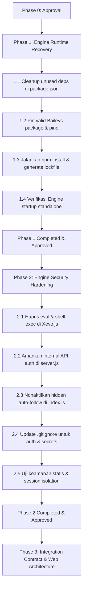

# PHASE 0 — DISCOVERY, VERIFICATION, DAN REMEDIATION PLAN

> **Dokumen:** `docs/plans/PHASE-0-DISCOVERY-AND-REMEDIATION.md`  
> **Status:** Draft Siap Review (Mode Read-Only Selesai)  
> **Tanggal:** 22 November 2026  
> **Target Approval:** `APPROVE PHASE-0`

---

## A. Objective

1. Melakukan verifikasi faktual terhadap seluruh source code XevoBotWa di workspace tanpa mengubah file apapun (read-only discovery).
2. Mengidentifikasi akar masalah (*root cause analysis*) dari kegagalan instalasi `npm ERR! ERESOLVE` (berdasarkan bukti log/screenshot pada `docs/screenshooth-error.jpeg`) dan kondisi dependency tree aktual.
3. Memverifikasi status 15 temuan keamanan (SEC-01 s/d SEC-15) dari PRD terhadap source code yang ada.
4. Menyusun dua rencana terperinci untuk fase berikutnya:
   - **Engine Runtime Recovery Plan** (Phase 1)
   - **Engine Security Hardening Plan** (Phase 2)
5. Memberikan rekomendasi teknis yang jelas sebelum masuk ke pembangunan web platform.

---

## B. Current Findings & Root-Cause Analysis

### 1. Struktur Workspace & Kondisi Repository Aktual

- **File Utama:**
  - `package.json` (574 bytes): Mendefinisikan dependencies dan script startup.
  - `package-lock.json`: **TIDAK ADA** (False). Hal ini menyebabkan instalasi tidak *deterministic/reproducible*.
  - `node_modules/`: **TIDAK ADA** (False). Dependencies belum terinstal di workspace saat ini.
  - `index.js` (11.556 bytes): WhatsApp Multi-Session Manager & lifecycle connection.
  - `Xevo.js` (30.625 bytes): Command parser, game mini-apps, dan handler pesan.
  - `server.js` (13.926 bytes): Raw Node.js HTTP server (API, static files, auth, chat).
  - `start.js` (3.182 bytes): Process runner untuk `server.js` dan Cloudflare Quick Tunnel.
  - `lib/msg.js` (2.817 bytes): Message wrapper dan Baileys socket helper.
  - `config.json` (460 bytes): Konfigurasi bot dan nomor owner.
  - `public/index.html` (46.299 bytes): Halaman web monolitik dashboard.
  - `public/background.mp4` (4.554.700 bytes): Video latar auth screen.
  - `docs/screenshooth-error.jpeg`: Screenshot error konsol Pterodactyl.

---

### 2. Diagnosis Mendalam: `npm ERR! ERESOLVE unable to resolve dependency tree`

Berdasarkan investigasi silang antara `docs/screenshooth-error.jpeg`, `package.json`, dan registry npm:

#### Bukti dari Screenshot (`docs/screenshooth-error.jpeg`):
Error pada konsol Pterodactyl (Node.js container v20.20.2):
```text
npm error code ERESOLVE
npm error ERESOLVE could not resolve
npm error While resolving: @poucode/baileys@1.0.0
npm error Found: jimp@0.22.12
npm error node_modules/jimp
npm error   jimp@"^0.22.12" from the root project
npm error Could not resolve dependency:
npm error peerOptional jimp@"^1.6.1" from @whiskeysockets/baileys@1.0.0
npm error node_modules/@whiskeysockets/baileys
npm error   @whiskeysockets/baileys@"github:senzystur/senzyganteng" from the root project
npm error Conflicting peer dependency: jimp@1.7.0
```

#### Root Cause 1: Konflik Peer Dependency Jimp
1. Baileys v7 (baik versi official maupun fork `senzystur/senzyganteng`) memerlukan `jimp: "^1.6.1"`.
2. Pada `package.json` root project, tertulis `"jimp": "^0.22.12"`.
3. Mulai npm v7+, npm melakukan resolusi peer dependency secara ketat. Karena `0.22.12` dan `^1.6.1` incompatible, npm melempar fatal error `ERESOLVE`.

#### Root Cause 2: Dependency "Hantu" yang Tidak Pernah Digunakan
Pemeriksaan kode terhadap seluruh file `.js` membuktikan bahwa dependency berikut **sama sekali tidak di-import/digunakan**:
- `jimp` (0 match)
- `chalk` (0 match)
- `fflate` (0 match)
- `ffmpeg-static` (0 match)
- `fluent-ffmpeg` (0 match)
- `file-type` (0 match)
- `node-webpmux` (0 match)

Pada [Xevo.js baris 10](file:///c:/Users/THINKPAD/Documents/webdev/BOT-WHATSAPP/Xevo.js#L10), developer sebelumnya mencatat:
> *"Removed: AI, sticker dependency, and message-flood/bug functionality."*

Fitur stiker dan manipulasi gambar sudah dihapus dari kode, namun dependency `jimp`, `ffmpeg`, dsb **dibiarkan tertinggal di `package.json`**, memicu konflik fatal `ERESOLVE`.

#### Root Cause 3 (KRITIS): `@whiskeysockets/baileys: "npm:nachles@latest"` adalah Dummy Package!
Untuk mencoba mengatasi error di atas, di file `package.json` saat ini dependency Baileys diubah menjadi:
```json
"@whiskeysockets/baileys": "npm:nachles@latest"
```
Hasil inspeksi langsung ke registry npm:
- Package `nachles` versi `0.0.1-security` adalah **Security Holding Package** milik npm (`npm <npm@npmjs.com>`) yang di-quarantine/takedown 2 minggu lalu!
- Ukurannya hanya **420 bytes**, tidak berisi kode Baileys sama sekali.
- Jika dijalankan, proses Node.js akan langsung crash dengan `Cannot find module '@whiskeysockets/baileys'` atau error serupa karena package tersebut kosong!

---

### 3. Verifikasi Keamanan Aktual (SEC-01 s/d SEC-15)

| ID | Temuan PRD | Lokasi Kode Aktual | Status Verifikasi | Tingkat Bahaya |
|---|---|---|---|---|
| **SEC-01** | `eval()` arbitrary code execution | [Xevo.js baris 82-96, 280, 492](file:///c:/Users/THINKPAD/Documents/webdev/BOT-WHATSAPP/Xevo.js#L82-L96) | **Terverifikasi Masih Ada** | 🔴 **CRITICAL** |
| **SEC-02** | `exec()` arbitrary shell command | [Xevo.js baris 282-293](file:///c:/Users/THINKPAD/Documents/webdev/BOT-WHATSAPP/Xevo.js#L282-L293) | **Terverifikasi Masih Ada** | 🔴 **CRITICAL** |
| **SEC-03** | Pairing endpoint publik tanpa auth | [server.js baris 283-297](file:///c:/Users/THINKPAD/Documents/webdev/BOT-WHATSAPP/server.js#L283-L297) | **Terverifikasi Masih Ada** | 🔴 **HIGH** |
| **SEC-04** | Session list publik membocorkan nomor | [server.js baris 219-221](file:///c:/Users/THINKPAD/Documents/webdev/BOT-WHATSAPP/server.js#L219-L221) | **Terverifikasi Masih Ada** | 🔴 **HIGH** |
| **SEC-05** | Dashboard stats terbuka publik | [server.js baris 223-238](file:///c:/Users/THINKPAD/Documents/webdev/BOT-WHATSAPP/server.js#L223-L238) | **Terverifikasi Masih Ada** | 🟡 **MEDIUM** |
| **SEC-06** | Web token in-memory volatil | [server.js baris 17, 41-50](file:///c:/Users/THINKPAD/Documents/webdev/BOT-WHATSAPP/server.js#L17) | **Terverifikasi Masih Ada** | 🟡 **MEDIUM** |
| **SEC-07** | File JSON lokal sebagai database | [server.js baris 14-27](file:///c:/Users/THINKPAD/Documents/webdev/BOT-WHATSAPP/server.js#L14-L27) | **Terverifikasi Masih Ada** | 🟡 **MEDIUM** |
| **SEC-08** | `ownerNumber` plain di `config.json` | [config.json baris 2-3](file:///c:/Users/THINKPAD/Documents/webdev/BOT-WHATSAPP/config.json#L2-L3) | **Terverifikasi Masih Ada** | 🟡 **MEDIUM** |
| **SEC-09** | Auto-follow 2 channel tanpa consent | [index.js baris 22-44, 205](file:///c:/Users/THINKPAD/Documents/webdev/BOT-WHATSAPP/index.js#L22-L44) | **Terverifikasi Masih Ada** | 🟡 **MEDIUM** |
| **SEC-10** | Tidak ada CSRF protection | [server.js baris 128, 170, 202](file:///c:/Users/THINKPAD/Documents/webdev/BOT-WHATSAPP/server.js#L128) | **Terverifikasi Masih Ada** | 🟡 **MEDIUM** |
| **SEC-11** | Rate limit in-memory dan IP-only | [server.js baris 11, 101-112](file:///c:/Users/THINKPAD/Documents/webdev/BOT-WHATSAPP/server.js#L11) | **Terverifikasi Masih Ada** | 🟡 **MEDIUM** |
| **SEC-12** | `auth/` & `database/` belum di `.gitignore` | [.gitignore baris 1-3](file:///c:/Users/THINKPAD/Documents/webdev/BOT-WHATSAPP/.gitignore#L1-L3) | **Terverifikasi Masih Ada** | 🔴 **HIGH** |
| **SEC-13** | `.public`/`.self` bisa diubah siapa saja | [Xevo.js baris 478-486](file:///c:/Users/THINKPAD/Documents/webdev/BOT-WHATSAPP/Xevo.js#L478-L486) | **Terverifikasi Masih Ada** | 🟡 **MEDIUM** |
| **SEC-14** | Validasi input nomor sangat minim | [index.js baris 72-74](file:///c:/Users/THINKPAD/Documents/webdev/BOT-WHATSAPP/index.js#L72-L74) | **Terverifikasi Masih Ada** | 🟡 **MEDIUM** |
| **SEC-15** | Image proxy terbuka untuk SSRF via redirect | [server.js baris 241-270](file:///c:/Users/THINKPAD/Documents/webdev/BOT-WHATSAPP/server.js#L241-L270) | **Terverifikasi Masih Ada** | 🟡 **MEDIUM** |

---

### 4. Lifecycle & Runtime Issues di `start.js`

1. **Keterikatan OS Linux:**  
   [start.js baris 16-22](file:///c:/Users/THINKPAD/Documents/webdev/BOT-WHATSAPP/start.js#L16-L22) secara eksplisit melempar error di luar Linux (`cloudflared-linux-*`). Aplikasi tidak dapat dijalankan di Windows developer machine menggunakan `start.js`.
2. **Keterikatan Quick Tunnel:**  
   `start.js` mengaitkan startup server dengan Cloudflare Quick Tunnel ephemeral. Subdomain tunnel acak berganti setiap server restart.
3. **Ketiadaan Process Supervisor:**  
   `start.js` menggunakan child process raw tanpa restart backoff otomatis yang tangguh seperti PM2 / systemd.

---

### 5. Status Lisensi dan Kepemilikan Source Code

- `package.json` menyatakan `"author": "LevviCode"`.
- Header [Xevo.js baris 5](file:///c:/Users/THINKPAD/Documents/webdev/BOT-WHATSAPP/Xevo.js#L5) menyatakan: *"Source basis: LevviCode Xevo.js (credit retained). Adapted for the current multi-session/pairing infrastructure."*
- Tidak ada file `LICENSE` resmi di repositori.
- **Kesimpulan Status:** Kode basis adalah open-source bot WhatsApp publik (LevviCode/Nachles). Perlu kejelasan hak penggunaan komersial jika dijadikan platform SaaS berbayar.

---

## C. Scope Phase 1 & Phase 2 (Remediation)

### Termasuk dalam Remediation:
- **Phase 1 (Runtime Recovery):**
  - Mengembalikan dependency Baileys ke rilis Baileys yang valid dan stabil (official `@whiskeysockets/baileys@^6.7.24` atau pinned `7.0.0-rc14` yang teruji).
  - Membersihkan 7 dependency tidak terpakai dari `package.json`.
  - Menghasilkan `package-lock.json` yang bersih dan reproducible (`npm ci` passing).
  - Memisahkan runtime Engine dari script Cloudflare tunnel `start.js`.
  - Menambahkan script health-check dan graceful shutdown pada Engine.
- **Phase 2 (Security Hardening):**
  - Menghapus fungsi `executeEval` (`.eval`, `]>`) dan shell execution (`$`).
  - Menutup endpoint pairing dan session list dari akses publik tanpa otorisasi.
  - Mengubah komunikasi Engine API menjadi private internal API (service-to-service auth via secret token).
  - Menambahkan perlindungan role pada command `.public` dan `.self`.
  - Mematikan `autoFollowChannels` tersembunyi (default disabled).
  - Menambahkan `auth/`, `database/`, dan `.env*` ke `.gitignore`.
  - Memperbaiki validasi image proxy agar tidak rentan open-redirect SSRF.

### Tidak Termasuk (Di luar Scope):
- Belum membuat aplikasi Next.js (App Router, Tailwind, dsb).
- Belum membuat database migration Supabase atau setup Redis.
- Belum melakukan pairing ke nomor WhatsApp sungguhan.
- Belum membuat landing page, dashboard UI, atau billing.

---

## D. Proposed Changes (Tabel Rencana Perubahan File)

| File | Action | Detail Rencana Perubahan | Alasan Teknis |
|---|---|---|---|
| `package.json` | **Modify** | 1. Hapus dependency tidak terpakai (`chalk`, `fflate`, `ffmpeg-static`, `file-type`, `fluent-ffmpeg`, `jimp`, `node-webpmux`).<br>2. Pin `@whiskeysockets/baileys` ke versi resmi valid (`^6.7.24` atau `7.0.0-rc.X`).<br>3. Tambahkan script `test` dan `engine`. | Memperbaiki error `ERESOLVE` dan mengganti dummy security package `nachles`. |
| `.gitignore` | **Modify** | Tambahkan `auth/`, `database/`, `.env`, `.env.local`, `*.tmp`. | Mencegah kebocoran credential WhatsApp dan database lokal ke Git (SEC-12). |
| `Xevo.js` | **Modify** | 1. Hapus fungsi `executeEval` dan blok `trimmed.startsWith(']>')` & `case 'eval'`.<br>2. Hapus blok `trimmed.startsWith('$')` (shell exec).<br>3. Batasi `case 'public'` dan `case 'self'` dengan pengecekan `isCreator(m)`. | Menutup RCE Critical (SEC-01, SEC-02) dan privilege escalation (SEC-13). |
| `index.js` | **Modify** | 1. Nonaktifkan `autoFollowChannels` secara default.<br>2. Tambahkan mekanisme binding ownership/tenant identifier pada session object.<br>3. Tambahkan graceful socket cleanup saat process SIGTERM/SIGINT. | Menghilangkan auto-follow tanpa consent (SEC-09) dan mencegah zombie WebSocket. |
| `server.js` | **Modify** | 1. Tambahkan middleware `INTERNAL_API_SECRET` untuk endpoint `/api/pairing` dan `/api/sessions`.<br>2. Hapus ekspos data nomor plaintext secara publik.<br>3. Perbaiki validasi redirect pada image proxy agar memverifikasi target host. | Menutup akses publik tidak berizin ke Engine (SEC-03, SEC-04, SEC-15). |
| `start.js` | **Refactor/Deprecate** | Pisahkan Engine runner murni dari Cloudflare Tunnel; buat runner mandiri yang cross-platform (Windows & Linux). | Menghilangkan ketergantungan OS Linux dan kegagalan startup pada Windows developer environment. |
| `config.json` | **Modify** | Pindahkan `ownerNumber` dan secret ke Environment Variable fallback. | Mengamankan nomor owner agar tidak bergantung pada file statis yang mudah tertulis (SEC-08). |

---

## E. Implementation Steps (Urutan Pengerjaan Granular)



---

## F. Data/Environment Changes

1. **Environment Variables Baru (untuk Engine):**
   - `PORT`: Port HTTP engine (default: `5004`).
   - `ENGINE_INTERNAL_SECRET`: Secret token untuk komunikasi Next.js ↔ Engine (Service-to-Service).
   - `OWNER_NUMBER`: Nomor owner WhatsApp bot (menggantikan hardcoded di `config.json`).
   - `ENABLE_AUTO_FOLLOW`: Boolean flag (default: `false`).
2. **File System:**
   - Folder `auth/` tetap ada secara lokal namun wajib diabaikan oleh Git via `.gitignore`.
   - Tidak ada pembuatan database eksternal pada Phase 1 & 2 (Supabase baru dikonfigurasi pada Phase 3 & 4).

---

## G. Risks & Impact

| Risiko | Dampak | Mitigasi |
|---|---|---|
| Perubahan versi Baileys merusak fitur rich message / mini apps di `Xevo.js` | Command `.dadu`, `.catur`, `.flappy` berpotensi error jika format protobuf berbeda | Uji fungsi payload `relayMessage` secara lokal menggunakan mock socket sebelum rilis |
| Penghapusan `eval` & shell exec membatasi debugging owner via WhatsApp | Owner tidak bisa lagi menjalankan script shell lewat chat WA | Ini risiko yang sengaja diambil demi keamanan sistem (RCE eliminasi total). Debugging dilakukan melalui SSH server resmi. |
| Endpoint Engine di-protect secret token sehingga frontend lama (`index.html`) tidak langsung terhubung | Panel HTML monolitik lama tidak bisa pairing tanpa secret header | Frontend lama akan digantikan secara resmi oleh Next.js pada Phase 4 & 5. |

---

## H. Tests Plan

### Phase 1 Test Plan (Runtime):
- [ ] **Clean Install Test:** `npm ci` berhasil tanpa warning `ERESOLVE`.
- [ ] **Lockfile Integrity Test:** File `package-lock.json` terbuat dan konsisten.
- [ ] **Syntax & Import Test:** Seluruh modul (`index.js`, `server.js`, `Xevo.js`, `lib/msg.js`) dapat di-load oleh Node.js tanpa error sintaksis.
- [ ] **Engine Standalone Boot Test:** Engine dapat menyala pada port 5004 tanpa memerlukan binary `cloudflared`.
- [ ] **Graceful Shutdown Test:** Mengirim sinyal `SIGINT` menutup socket tanpa proses orphan.

### Phase 2 Test Plan (Security):
- [ ] **Eval Execution Elimination Test:** Mengirim pesan `]> 1+1` atau `.eval` menghasilkan pesan penolakan / command tidak dikenal.
- [ ] **Shell Execution Elimination Test:** Mengirim pesan `$ ls` menghasilkan penolakan total.
- [ ] **Unauthorized API Request Test:** Request ke `POST /api/pairing` tanpa header `x-engine-secret` ditolak dengan `401 Unauthorized`.
- [ ] **Session List Leak Test:** `GET /api/sessions` tanpa secret ditolak dengan `401 Unauthorized`.
- [ ] **Gitignore Secret Leak Test:** `git status` memastikan folder `auth/` dan `database/` tidak terlacak.
- [ ] **Consent Auto-Follow Test:** Event `connection.update` = 'open' tidak memicu follow channel jika `ENABLE_AUTO_FOLLOW=false`.

---

## I. Rollback

- Seluruh file asli saat ini masih tersimpan dalam arsip `XevoBotWa.zip`.
- Jika implementasi Phase 1 atau Phase 2 mengalami kendala, perubahan file individual dapat di-revert secara instan menggunakan backup lokal atau git checkout.

---

## J. Acceptance Criteria

Phase 0 dinyatakan selesai apabila:
1. [x] Dokumen `docs/plans/PHASE-0-DISCOVERY-AND-REMEDIATION.md` tersusun lengkap dan akurat sesuai fakta source code.
2. [x] Root cause `npm ERR! ERESOLVE` dan status dummy `nachles@0.0.1-security` teridentifikasi secara tuntas.
3. [x] Seluruh 15 temuan keamanan PRD terverifikasi lokasinya di kode.
4. [x] Rencana tindakan per file untuk Phase 1 dan Phase 2 terdefinisi jelas.
5. [x] Pemilik project membaca dan memberikan persetujuan eksplisit `APPROVE PHASE-0`.

---

## K. Decisions Needed from Owner

Sebelum mengeksekusi Phase 1, mohon konfirmasi untuk 2 hal berikut:
1. **Pilihan Versi Baileys:**
   Apakah disetujui untuk menggunakan rilis resmi `@whiskeysockets/baileys@^6.7.24` (paling stabil untuk multi-session production) atau tetap mencoba Baileys v7 RC (`7.0.0-rc14`)? *(Rekomendasi: v6.7.24 untuk stabilitas maksimal).*
2. **Pembersihan Dependency Tidak Terpakai:**
   Apakah disetujui untuk mencopot dependency stiker/video yang sudah tidak dipakai (`jimp`, `ffmpeg-static`, `fluent-ffmpeg`, `node-webpmux`, `chalk`, `fflate`, `file-type`) dari `package.json`?

---

## L. Approval Request

Seluruh inspeksi Phase 0 telah selesai dilakukan dalam mode read-only tanpa mengubah file apapun.

Silakan tinjau rencana di atas. Untuk melanjutkan ke implementasi **Phase 1 (Engine Runtime Recovery)**, silakan berikan persetujuan dengan mengirim:

`APPROVE PHASE-0`
